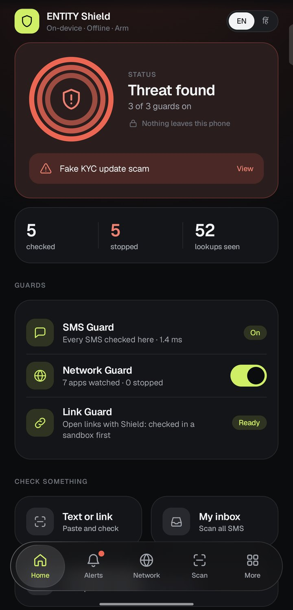
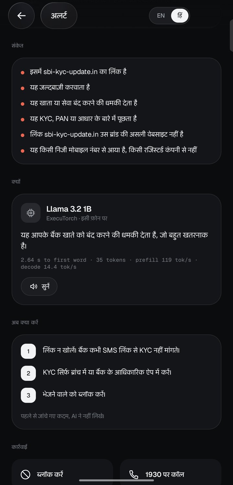

<div align="center">

# ENTITY Shield

**On-device threat, phishing and scam detection for Arm Android phones**

A scam SMS, a phishing link or a misbehaving app is flagged in milliseconds, and Llama 3.2 explains
it in English or Hindi. No cloud. Works in airplane mode on a mid-range phone.

Bharat AI-SoC Challenge 2026–27 · Problem Statement 3 · Team ENTITY

[](../../releases/latest)


</div>

<p align="center">





</p>
<p align="center"><sub>Screenshots from an Infinix X6878 (Snapdragon 7s Gen 3), version 0.4.0. Left to right: home · a scam SMS explained by Llama · the same alert in Hindi · a link followed in the sandbox · Network Guard.</sub></p>

## Overview

ENTITY Shield is an Android app that protects the phone it runs on. Everything happens on the device:

- **Two small ExecuTorch detectors decide.** An SMS model and a URL model score every message, link and
  DNS lookup in about 1–5 ms on the Arm CPU.
- **Links are followed, not guessed.** A sandbox visits the link, and the page is read inside an
  Android isolated process that has no files and no network.
- **Network Guard watches every app.** A local DNS-only VPN names the app behind each lookup, stops
  reported phishing hosts and spots malware behaviour (beacons, DGA bursts, DNS tunnelling). A LAN
  tripwire catches scans from the same Wi-Fi.
- **Llama 3.2 1B on ExecuTorch explains.** It says why *this* item is dangerous, in English or Hindi,
  and answers follow-up questions. It never decides and never writes the remediation steps.

## Highlights in 0.4.0

| | 0.3.0 | 0.4.0 |
|---|---|---|
| Real long-tail DNS lookups blocked by mistake | 21.5% | **0.03%** |
| Held-out phishing domains stopped by the model alone (OpenPhish) | 93% | 87% |
| Links | judged from the address | **followed and read in an isolated sandbox** |
| Janky frames, CMF Phone 1 / Infinix X6878 | 4.0% / 7.1% | **1.15% / 2.4%** |
| Worst frames (p99), CMF Phone 1 | 1,100 ms | **65 ms** |
| APK size | 33 MB | **17 MB** |
| Llama setup | `adb push` | **one tap in the app** (resumable, SHA-256 checked) |

**Status, 19 Nov 2026.** `scripts/e2e_phone.py` passes **19/19** checks on both test phones, a CMF
Phone 1 (Dimensity 7300) and an Infinix X6878 (Snapdragon 7s Gen 3), running the release code:
- detector parity with training, and link-sandbox isolation (files and network denied);
- a live visit to a real bank site, judged safe;
- six SMS verdicts in English, Hindi and Hinglish;
- Llama 3.2 explaining in English and Hindi through ExecuTorch inside the app;
- Network Guard letting ordinary lookups through, blocking a reported phishing host, flagging a
  look-alike and catching a DGA burst.

Raw: [`e2e_A015_2026-11-19.json`](benchmarks/results/e2e_A015_2026-11-19.json),
[`e2e_Infinix_X6878_2026-11-19.json`](benchmarks/results/e2e_Infinix_X6878_2026-11-19.json).

Every number in this README is measured, and its raw file is in [`benchmarks/results/`](benchmarks/results).
Nothing is projected. The day-by-day record is in [`docs/PLAN.md`](docs/PLAN.md#0-progress-log) and the
full write-up is the [technical report](docs/report/ENTITY-Shield-Report.pdf).

## Capabilities

Each Problem Statement 3 requirement and what runs on the phone for it.

| PS3 asks for | ENTITY Shield | Model / runtime |
|---|---|---|
| **Monitor network traffic for anomalies and intrusions** | **Network Guard** has two parts. (1) A local DNS-only VPN: every app's lookups are checked and attributed to the app. Only reported phishing hosts and near-certain fakes are stopped; popular sites, the app's own servers and sites the user allowed never are. Malware behaviour is flagged (fixed-timer beacons, DGA lookup bursts, DNS tunnelling). (2) A LAN tripwire on decoy ports catches port scans, password guessing and ADB-worm probes from the same Wi-Fi | URL detector (ExecuTorch) + behaviour rules |
| **Detect phishing URLs** | Links inside SMS, links shared to Shield, **Link Guard** (open any link with Shield: checked first, then your browser), "Check with Shield" on selected text. **The link sandbox follows the link:** the phone fetches it with no cookies and no JavaScript. It parses the page inside an Android *isolated process*, which has no files and no network. It reports where the link really goes and what the page asks for (UPI PIN, OTP, Aadhaar, card + CVV). It also flags brand copies, look-alike domains and data sent to Telegram bots | URL detector, `url.pte` + page analysis + the SMS model on the page's words |
| **Detect scam SMS and fraudulent communications** | Every incoming SMS, plus an on-device audit of the whole inbox | SMS detector, `sms.pte` (ExecuTorch, XNNPACK) |
| **Explain threats to non-experts in plain language** | "Why" for *this* message, streamed, in **English or Hindi**, read aloud | **Llama 3.2 1B Instruct on ExecuTorch** (`LlmModule`) |
| **Recommend remediation** | Fixed, pre-checked steps per scam family (never generated) + actions that act: block the sender, call 1930, report on cybercrime.gov.in, copy a report, remove the app, leave the Wi-Fi; follow-up questions answered by Llama inside the checked steps | Rules + Llama |
| **Process data locally** | Nothing leaves the phone ([privacy](docs/PRIVACY.md)). Detection and explanation work in airplane mode | All on the Arm CPU |

**Design rule: detectors decide, Llama explains.** The verdict and the steps come from the detectors and
fixed text. The app writes the opening of Llama's answer ("No, this SMS is a scam. Why:"), so Llama
cannot overturn a verdict or invent advice. Details: [`docs/ARCHITECTURE.md`](docs/ARCHITECTURE.md).

## Results

### Detectors: accuracy (held-out data, threshold set on validation for ≤ 1% false alarms)

SMS rows are the 0.5.1 model (`benchmarks/results/detector_sms_2026-11-21.json`) and the app's full
verdict on the same held-out split (`scripts/eval_sms_heldout.py`,
`benchmarks/results/sms_heldout_app_2026-11-21.json`). The 0.5.1 model alone is weaker on unseen
templates than 0.5.0's (recall 0.90 -> 0.67): it was retrained to stop treating marketing as fraud, and
the scam gate now makes the final call. UCI is UK spam from 2011; the gate looks for fraud cues seen in
Indian scams, so it lets more of that through. The gate's rules were tuned on a challenge set and one
real inbox (below); only the 19 "fresh" challenge messages were written after tuning.

| Detector · test set | n | Precision | Recall | False-alarm rate | AUC |
|---|---:|---:|---:|---:|---:|
| SMS model alone · UCI SMS Spam, fraud-only positives (held out) | 788 | 1.000 | 0.783 | 0.00% | 0.990 |
| SMS model alone · **Indian scam/legit templates never seen in training** | 1,200 | 0.848 | 0.668 | 6.00% | 0.952 |
| SMS **app verdict** (model + URL model + scam gate) · same Indian templates, "scam" | 1,200 | 0.973 | 0.715 | 1.00% | — |
| SMS **app verdict** · same Indian templates, "scam" or "be careful" | 1,200 | 0.905 | 0.933 | 4.88% | — |
| SMS **app verdict** · UCI, "scam" or "be careful" | 788 | 0.905 | 0.633 | 0.55% | — |
| URL v3 · PhishTank **newer than all training data** + real DNS hostnames and Tranco domains (with allow-list) | 19,873 | 0.938 | 0.526 | 0.72% | 0.898 |
| URL v3 · OpenPhish feed of 19 Nov 2026 (recall only) | 297 | — | 0.923 | — | — |
| URL v3 · 20,000 held-out real DNS hostnames (Umbrella ranks 600k–1M), false alarms only | 20,000 | — | — | 1.06% (0.1% at Network Guard's threshold) | — |
| URL · 41 official Indian bank/UPI/government domains | 41 | — | — | **0%** | — |

- **Splits:** the SMS test uses *templates*, not just messages, that were never trained on. The URL
  test is a time split: train ≤ 2026-06-04, test ≥ 2026-08-07.
- **Reproducibility:** retraining the SMS model on Windows reproduced the 13 Nov Mac model
  exactly (43/43 golden scores, max difference 0.0).
- **Real-inbox false-alarm audit:** pending.
- **URL v3 vs v1:** v1's benign data held only bare domains (flipkart.com). On the new test, whose
  benign side includes real hostnames (api.x.io, connekt.flipkart.net), v1 had precision 0.38 and 23%
  false alarms. v3 adds real DNS names from the Cisco Umbrella list, split by domain so nothing leaks,
  and a sharper `brand_lure` signal. Recall on this harder test is lower than v1's 0.661 on the easier
  old one. Raw: [`detector_url_2026-11-19.json`](benchmarks/results/detector_url_2026-11-19.json).

### Network Guard: false alarms (v1 → v2)

v1 blocked a lookup whenever the URL model said "scam". Apps look up thousands of hostnames a day, so
it blocked ordinary traffic. On the Infinix it stopped the phone maker's own Messages servers,
Airtel's backend and an Indian SMS-link service. v2 (`net/DnsPolicy.kt`) decides in this order:
1. Local names, OS/CDN infrastructure and sites the user allowed: let through.
2. Hosts on the bundled PhishTank/OpenPhish list: blocked.
3. Popular domains (Tranco top 1M) and domains that belong to the app asking: let through.
4. The URL model at a strict threshold: blocked.
5. Anything else the model doubts: flagged in the list, never blocked or notified.

| Blocked by mistake / phishing caught | v1 | **v2** |
|---|---:|---:|
| Long-tail legitimate domains with real subdomain prefixes (20,000) | 21.5% | **0.03%** |
| Held-out real DNS hostnames, Umbrella ranks 600k–1M (20,000) | 10.5% | **0.12%** |
| PhishTank time-split test (3,393), by the model alone | 65% | 33% (the feed list adds the known ones) |
| OpenPhish held-out (297), by the model alone | 93% | 87% |
| The 4 hosts v1 wrongly blocked on the Infinix | blocked | **allowed** |

The leftover v2 mistakes are mostly app backends on free hosts (Firebase, Pages). Those are blocked
only when a browser asks, and only flagged inside other apps. Raw:
[`dns_policy_eval_2026-11-19.json`](benchmarks/results/dns_policy_eval_2026-11-19.json),
`scripts/eval_dns_policy.py`.

### Link sandbox: follow the link vs read the address

On the CMF Phone 1, the sandbox visited live links from the OpenPhish feed of 19 Nov 2026 and real
Indian sites. Two samples: the **tuning** sample set the signal weights, and the **held-out** sample
(different links, never looked at while tuning) checks them.

| Live links that answered | Address only: scam / unsure / safe | **Sandbox**: scam / unsure / safe |
|---|---|---|
| Phishing, tuning (34) | 24 / 3 / 7 | **26 / 3 / 5** |
| Phishing, held-out (32) | 28 / 0 / 4 | 27 / 1 / 4 |
| Big Indian brands: banks, government, payments, shopping (39) | 0 / 0 / 39 | 0 / 1 / 38 |
| Random long-tail `.in` sites, tuning (32) | 0 / 2 / 30 | 0 / 3 / 29 |
| Random long-tail `.in` sites, held-out (32) | 1 / 3 / 28 | 1 / 5 / 26 |

- **Honest reading:** on the held-out sample, following the link did not catch more phishing than the
  address model already did, and it made two more ordinary sites "unsure". Its value is in what the
  address cannot show: where a link really lands, what the page asks for, and where the form sends it.
- **Catches what the address hides:** `auth.re/…` scores 8% on its address, but its page copies a
  brand and asks for a password. A Netlify page titled "Free Fire" sends whatever is typed straight to
  a Telegram bot (screenshot above).
- **Found on the held-out sample, fixed in 0.4.0:** one phishing kit sent the sandbox on to the real
  `roblox.com`, and the trusted landing site cleared the link. A risky address that redirects to a
  trusted site now stays flagged ("cloaking"). Because the held-out sample found it, that case no
  longer counts as held out; the table shows the held-out run before the fix.
- **Nothing to read is not "safe":** a page that is gone (404), an address that no longer exists or a
  server that never answers is reported as "Couldn't check this link", and a link opened from a
  flagged message keeps that message's verdict.
- **What did not work:** the first weights flagged 11 ordinary sites. A lone password box, right-click
  blocking, a fresh Let's Encrypt certificate and broken certificate chains are all common on honest
  Indian sites. They were demoted to weak signals.
- **Isolation, checked on both phones in every end-to-end run:** the parser runs under an isolated
  uid (`isolated=true`), and reading Shield's files and opening a socket both fail.
- Raw: [`sandbox_eval_tuning_A015_2026-11-19.json`](benchmarks/results/sandbox_eval_tuning_A015_2026-11-19.json),
  [`sandbox_eval_heldout_A015_2026-11-19.json`](benchmarks/results/sandbox_eval_heldout_A015_2026-11-19.json),
  `scripts/eval_sandbox.py`.

### App smoothness (Android's own frame statistics)

`scripts/bench_ui.py` taps through the tabs 30 times, including the far jumps (Home ↔ More), and
reads `dumpsys gfxinfo`. "Before" is the 0.3 pager-based debug build; "after" is the 0.4 code
optimized the way it ships (R8, startup profile).

| Phone | Janky frames | p95 frame | p99 frame |
|---|---|---|---|
| CMF Phone 1 (Dimensity 7300, 120 Hz) | 4.0% → **1.15%** | 150 → **48 ms** | 1100 → **65 ms** |
| Infinix X6878 (Snapdragon 7s Gen 3, 120 Hz) | 7.1% → **2.4%** | 53 → **27 ms** | 117 → **30 ms** |

Where it came from:
- **Tab host:** each tab is built once and kept, so a switch never builds a screen mid-animation.
  This replaced a pager that built every page in between.
- **No offscreen buffers** for the page fades.
- **Nothing per frame:** no file checks or icon decoding on the main thread, and the nav animates
  without recomposing.
- **Glass costs nothing measurable:** a run with the glass forced off had the same frame times.
- **Every device:** the glass falls back to blur-only on Android 12, and to a plain frosted tint on
  Android 10–11, low-RAM phones and Battery Saver.

### Detectors: on the phone

| | CMF Phone 1 (Dimensity 7300) | Infinix X6878 (Snapdragon 7s Gen 3) |
|---|---|---|
| Same score as training, through the production path | SMS 43/43 · URL 40/40 (max diff 5×10⁻⁷) | SMS 43/43 · URL 40/40 (max diff 5×10⁻⁷) |
| Full SMS check (featurize + both models), n = 1000 | p50 **0.64 ms** · p95 0.80 ms | p50 **0.50 ms** · p95 0.65 ms |
| URL check, n = 1000 | p50 **0.15 ms** · p95 0.17 ms | p50 **0.11 ms** · p95 0.15 ms |
| Model size | 130 KB each (`.pte`) | |
| SMS in → notification posted (time to first warning), 6 messages | median 189 ms, max 380 ms | median **38 ms**, max 58 ms |

- Measured in the 0.4 end-to-end runs with the code built the way it ships (R8). The 0.3 debug build
  took 5.0 ms (SMS) and 1.1 ms (URL) on the CMF.
- On the CMF, the later warnings ran while Llama was loading for the explanation the user is likely to
  open next (the pre-warm, 1.1 GB from storage). We have not yet measured the two apart. In the 0.3
  run, without Llama, the CMF warned in 22 ms.

### Llama 3.2 1B on ExecuTorch: where the threads go

`scripts/bench_threads.py`, ExecuTorch `llama_main`. Infinix X6878: Snapdragon 7s Gen 3, 1× A720 @
2.7 GHz + 3× A720 @ 2.4 GHz + 4× A520, with i8mm. QAT+LoRA 4-bit model, 165-token prompt, 3
interleaved runs per arm, plugged in, 29–30 °C.

| Arm | Prefill tok/s | Decode tok/s | Time to first token |
|---|---:|---:|---:|
| **4 threads pinned to the A720s** | **185.6 ± 0.6** | **19.2** | **0.89 s** |
| ExecuTorch default (picked 4 threads here) | 171.0 ± 4.4 | 18.7 | 0.96 s |
| 8 threads (a common app default) | 162.6 ± 8.1 | 15.5 | 1.01 s |
| 3 threads (what ExecuTorch picks on the Dimensity 7300) | 153.8 ± 2.8 | 19.0 | 1.07 s |
| 4 threads pinned to the A520 little cores | 47.5 ± 0.1 | 9.6 | 3.48 s |

**Findings:**

1. **Android silently moves ExecuTorch to the little cores.** Our first build ran Llama on a
   `THREAD_PRIORITY_BACKGROUND` thread. `/proc/<pid>/task/*/cgroup` showed every XNNPACK worker in
   `cpuset:/background`. Inside the app on the CMF that meant prefill at 25 tok/s and a 9.2 s first
   token. Llama now runs at normal priority, and only while the alert is on screen.
2. **ExecuTorch's core-count heuristic picks 3 threads on the Dimensity 7300**, because `midr_el1`
   is unreadable and it falls back. On the bigger SoC above, 3 instead of 4 threads costs 17% of
   prefill. This is an upstream-fix candidate, like ENTITY's merged llama.cpp PR #25701.
3. **ENTITY's llama.cpp finding holds on ExecuTorch and on Armv9.** Thread count matters: 8 threads
   cost 19% decode. Pinning to the big cores gives the fastest and steadiest prefill (±0.6 vs ±6.6).

### Llama in the app: cold vs pre-warmed

When an alert fires, Shield pre-fills the fixed system prompt (99 tokens) into ExecuTorch's KV cache
(`LlmModule.prefillPrompt`), so opening the alert only pays for the message's own 134 tokens. Infinix,
app in the foreground, same alert, greedy:

| | Prompt tokens processed | First token |
|---|---:|---:|
| Cold | 233 | 1.78 s |
| **Pre-warmed** | 134 | **1.00 s (−44%)** |

The pre-warmed answer matches the cold one for its first 14 tokens, then takes a different but
equally correct wording ("…trick victims into revealing sensitive information" vs "…get victims to
take action"). This is consistent with a near-tie flipping under a different floating-point summation
order when the prompt is prefilled in two chunks; we have not confirmed it directly. Removing the
literal BOS token from the prefilled text made the answers diverge from the first sentence, so
`prefillPrompt` adds no BOS of its own.

### Llama explanations: quality

`training/llm/eval_explanations.py`. 40 held-out scam messages (one per never-seen Indian scam
template, i.e. all 10 in the test split, plus 30 UCI spam) → the app's exact prompt → ExecuTorch on
the phone → automatic checks plus a manual review.

| | Automatic checks pass* | Manual review: correct / vague / **wrong** | Indian messages only |
|---|---:|---|---|
| English | 40/40 | 28 / 8 / **4** | 8 / 2 / **0** |
| Hindi, warning signs given in English (first version) | 39/40 | 18 / 16 / **6** | 4 / 4 / **2** |
| **Hindi, warning signs given in Hindi (shipped)** | **40/40** | 17 / 20 / **3** | **7** / 3 / **0** |

\* No refusals, no invented links or phone numbers, never calls a flagged message safe, stops by itself
(median 26 tokens in English, 47 in Hindi).

**What the review found:** the 4 English errors invent a "PIN/password" detail on UK premium-rate spam.
In Hindi, the first version *negated* the evidence twice ("did **not** come from a personal number"):
the 1B had to translate English signs while answering. Giving it the signs already in Hindi (A/B on the
same 40 messages) halved the wrong answers (6 → 3), removed the negations, and on the Indian messages
took correct answers from 4 to 7 with none wrong. That version ships. The steps the user acts on are
never generated.

## Quick start

1. Download `ENTITY-Shield-0.4.0.apk` from the [latest release](../../releases/latest) and install it
   (Android 10 or newer, arm64):
   ```
   adb install ENTITY-Shield-0.4.0.apk
   ```
   If an older test build is installed, uninstall it first; the signing key differs.
2. For explanations, open **More → On-device AI → Download Llama** (1.1 GB, resumable). Or copy the two
   release files yourself:
   ```
   adb push llama3_2_1b_instruct_qlora_ctx2048.pte tokenizer.model /sdcard/Android/data/app.entity.shield/files/models/
   ```
   Detection and the fixed steps work without the model.
3. **More → Demo scams**, then tap a sample. The verdict is instant, the warning signs follow, then
   Llama's explanation. Switch **EN / हिं** or tap **Read aloud**.
4. **Scan** tab: paste a link and keep **Visit from the sandbox** on to see where it really goes and what the
   page asks for.
5. **Network** tab: turn on **Network Guard** and browse. The optional `beaconsim-test.apk` from the
   release imitates malware lookups (DGA burst, beacon, DNS exfiltration) so detection can be seen.

On Android 13 and newer, a sideloaded app may need **App info → ⋮ → Allow restricted settings** before
the SMS permission can be granted.

## Build and reproduce

| Step | Command |
|---|---|
| Python environment (Windows, macOS, Linux) | `uv venv .venv --python 3.12`, then `uv pip install torch==2.14.0 executorch==1.5.1 "torchao>=0.18,<0.19"` |
| Datasets | `bash scripts/download_datasets.sh` |
| Train, export and golden vectors | `python training/train_detector.py sms`, `python training/train_detector.py url` |
| DNS lists (popularity and phishing hashes) | `python training/url/build_dns_lists.py` |
| App (Android SDK 36) | `cd android-app && ./gradlew assembleRelease` (or `assembleDebug`) |
| Unit tests | `cd android-app && ./gradlew :app:testDebugUnitTest` |
| End-to-end on a phone | `python scripts/e2e_phone.py --serial <id> --install --hindi` |
| Network Guard policy evaluation | `python scripts/eval_dns_policy.py` |
| Link sandbox evaluation | `python scripts/eval_sandbox.py --serial <id>` |
| Frame timing | `python scripts/bench_ui.py --serial <id>` |
| Thread ablation | `python scripts/bench_threads.py --serial <id>` |
| Explanation quality | `python training/llm/eval_explanations.py --serial <id> --mask f0` |
| Llama export (gated weights) | `training/llm/export_llama.sh`, see [`docs/PLAN.md`](docs/PLAN.md) |

On Windows, ExecuTorch 1.5.1's wheel needs `FLATC_EXECUTABLE` (`train_detector.py` sets it), file I/O
must be UTF-8, and `sdkmanager` needs `--package_file`.

## Limitations

- **Network Guard sees only this phone's traffic**, not other devices on the Wi-Fi. Strict Private DNS
  or an app's own DNS-over-HTTPS bypasses its DNS view. Android allows one VPN at a time.
- **The Indian SMS test set is templates**, hand-written in Hindi, Hinglish and English. The audit of
  a real inbox is the trust number and is still to do.
- **URL recall from the address alone is 0.53 on PhishTank and 0.92 on OpenPhish.** The model sees
  hostnames only, because the DNS view has no paths. The sandbox and the phishing list cover more.
- **The link sandbox reads HTML without running JavaScript.** Pages that build their form in script
  are judged on what the server sends, and some clones that ask for nothing still read as safe.
- **Llama 3.2 1B is wrong 10–15% of the time** in the manual review. That is why it never decides and
  never writes the steps.
- **Llama speed depends on the phone.** On the Dimensity 7300, ExecuTorch picks 3 threads.

## Repository layout

| Path | Contents |
|---|---|
| `android-app/app` | The app. Kotlin packages: `core` (featurizer, detectors, advice, pipeline), `llm` (Llama explainer, download, import), `net` (Network Guard), `sandbox` (link fetcher, page analyzer, isolated service), `sms`, `bench`, `ui` |
| `android-app/beaconsim` | Test-only app that imitates malware network behaviour (DNS lookups of made-up names) |
| `training/` | Featurizer, detector training and export, DNS lists, golden vectors, Llama export and explanation evaluation |
| `models/detectors/` | The shipped `.pte` detectors, thresholds and DNS lists |
| `scripts/` | End-to-end phone tests, evaluations, frame timing, thread ablation, LAN scan demo, demo recording |
| `benchmarks/results/` | Raw CSV and JSON behind every number in this README |
| `docs/` | [Architecture](docs/ARCHITECTURE.md), [privacy](docs/PRIVACY.md), [demo script](docs/DEMO.md), [plan and progress log](docs/PLAN.md), [technical report](docs/report/ENTITY-Shield-Report.pdf) |

## Licence and credits

**Created by V S Kamalesh** ([@kkjjkamal123](https://github.com/kkjjkamal123)), Team ENTITY.

Mixed licence ([`LICENSE`](LICENSE)): the detection, network and AI engine, the training code, the
scripts and the docs are Apache-2.0. The app's user interface is proprietary
([`LICENSE-PROPRIETARY.md`](LICENSE-PROPRIETARY.md)).

**Built with Llama.** Llama 3.2 is licensed under the Llama 3.2 Community License, Copyright © Meta
Platforms, Inc. All Rights Reserved.

Runtime: ExecuTorch (BSD-3-Clause), XNNPACK, Arm KleidiAI. Typefaces: Geist and Geist Mono (SIL OFL
1.1). Data: UCI SMS Spam Collection (CC BY 4.0), PhishTank, OpenPhish, Tranco, Cisco Umbrella. The
device-probe and benchmark method is reused from the author's
[ENTITY](https://github.com/kkjjkamal123/ENTITY---Arm-Create-AI-Optimization-Challenge) (Apache-2.0).
See [`THIRD_PARTY_NOTICES.md`](THIRD_PARTY_NOTICES.md).
