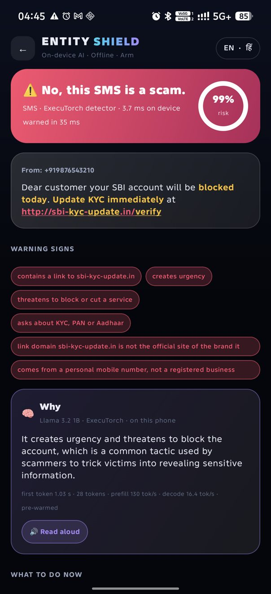
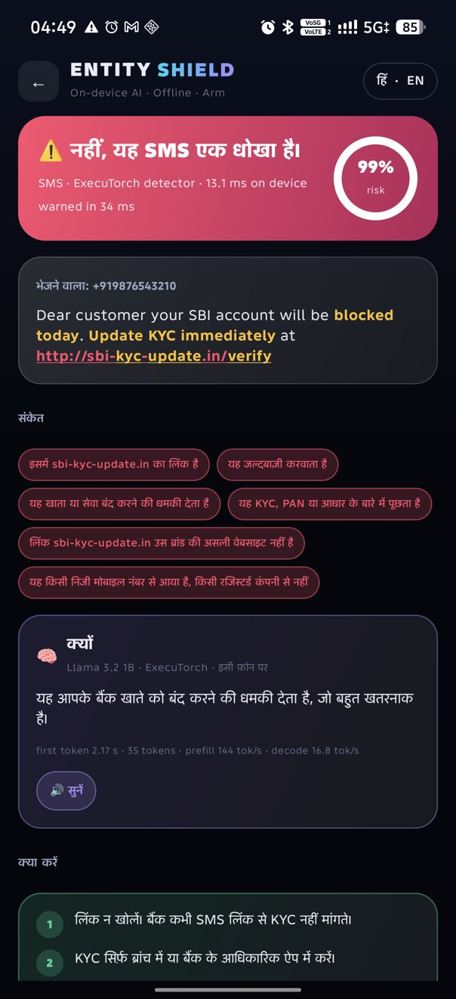
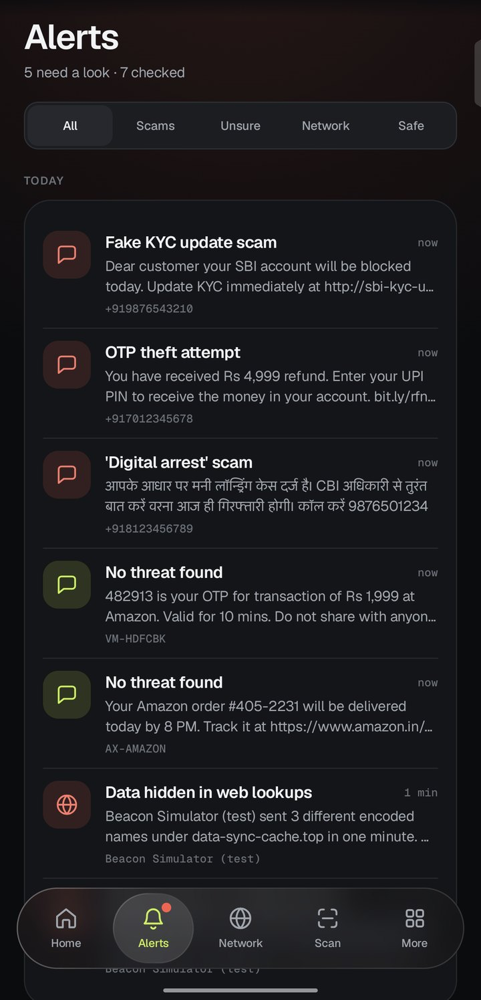
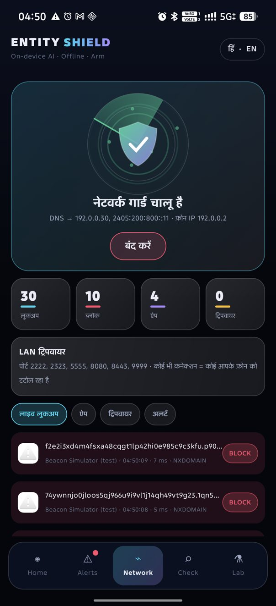

<div align="center">

# 🛡️ ENTITY Shield

**A scam SMS, a phishing link or a misbehaving app is flagged on the phone in milliseconds, and
Llama 3.2 explains it in English or Hindi. No cloud, works in airplane mode, on a mid-range Arm phone.**

Bharat AI-SoC Challenge 2026–27 · Problem Statement 3 · On-device threat, phishing & scam detection · Team ENTITY


</div>

> **New in 0.4 (2026-11-19, evening):**
> - **Network Guard no longer blocks ordinary sites.** v1 blocked 21.5% of real long-tail lookups;
>   v2 blocks 0.03% and still stops 87% of held-out phishing domains.
> - **Links are followed, not guessed:** an isolated sandbox visits the link and reads the page.
> - **A new design:** liquid glass, Geist type, no emoji.
> - **Smoother:** janky frames 4.0% to 1.15%, worst frames 1.1 s to 65 ms.
> - **Smaller:** the APK went from 33 MB to 17 MB.
>
> **Status, 2026-11-19 (Phase 1 is due 23 Nov):** the app runs end to end on a real phone.
> `scripts/e2e_phone.py` passes **15/15** checks on an Infinix X6878 (Snapdragon 7s Gen 3) in one run:
> - detector parity;
> - six SMS verdicts;
> - time to first warning (median 21.6 ms);
> - Llama 3.2 explaining in English and Hindi inside the app through ExecuTorch;
> - Network Guard blocking phishing domains and catching a DGA burst.
>
> Every number below is measured, with its raw file in [`benchmarks/results/`](benchmarks/results);
> nothing is projected. The day-by-day record is [`docs/PLAN.md`](docs/PLAN.md#0-progress-log).

<p align="center">





</p>
<p align="center"><sub>Real screenshots, Infinix X6878. Left to right: dashboard · a scam SMS explained by Llama (English) · the same alert in Hindi · alert feed with Network Guard catching a test app's DGA burst, DNS exfiltration and blocked lookups · Network Guard live view.</sub></p>

---

## What it does (PS3 capability → what runs on the phone)

| PS3 asks for | ENTITY Shield | Model / runtime |
|---|---|---|
| **Monitor network traffic for anomalies and intrusions** | **Network Guard** has two parts. (1) A local DNS-only VPN: every app's lookups are checked and attributed to the app. Only reported phishing hosts and near-certain fakes are stopped; popular sites, the app's own servers and sites the user allowed never are. Malware behaviour is flagged (fixed-timer beacons, DGA lookup bursts, DNS tunnelling). (2) A LAN tripwire on decoy ports catches port scans, password guessing and ADB-worm probes from the same Wi-Fi | URL detector (ExecuTorch) + behaviour rules |
| **Detect phishing URLs** | Links inside SMS, links shared to Shield, **Link Guard** (open any link with Shield: checked first, then your browser), "Check with Shield" on selected text. **The link sandbox follows the link:** the phone fetches it with no cookies and no JavaScript. It parses the page inside an Android *isolated process*, which has no files and no network. It reports where the link really goes and what the page asks for (UPI PIN, OTP, Aadhaar, card + CVV). It also flags brand copies, look-alike domains and data sent to Telegram bots | URL detector, `url.pte` + page analysis + the SMS model on the page's words |
| **Detect scam SMS and fraudulent communications** | Every incoming SMS, plus an on-device audit of the whole inbox | SMS detector, `sms.pte` (ExecuTorch, XNNPACK) |
| **Explain threats to non-experts in plain language** | "Why" for *this* message, streamed, in **English or Hindi**, read aloud | **Llama 3.2 1B Instruct on ExecuTorch** (`LlmModule`) |
| **Recommend remediation** | Fixed, pre-checked steps per scam family (never generated) + actions that act: block the sender, call 1930, report on cybercrime.gov.in, copy a report, remove the app, leave the Wi-Fi; follow-up questions answered by Llama inside the checked steps | Rules + Llama |
| **Process data locally** | Nothing leaves the phone ([privacy](docs/PRIVACY.md)). Detection and explanation work in airplane mode | All on the Arm CPU |

**Design rule: detectors decide, Llama explains.** The verdict and the steps come from the detectors and
fixed text. The app writes the start of Llama's answer ("⚠️ No, this SMS is a scam. Why:"), so Llama
cannot overturn a verdict or invent advice. Details: [`docs/ARCHITECTURE.md`](docs/ARCHITECTURE.md).

## Results

### Detectors: accuracy (held-out data, threshold set on validation for ≤ 1% false alarms)

| Detector · test set | n | Precision | Recall | False-alarm rate | AUC |
|---|---:|---:|---:|---:|---:|
| SMS · UCI SMS Spam (held out) | 837 | 0.974 | 0.942 | 0.42% | 0.997 |
| SMS · **Indian scam/legit templates never seen in training** | 840 | 0.978 | 0.903 | 1.82% | 0.982 |
| URL v3 · PhishTank **newer than all training data** + real DNS hostnames and Tranco domains (with allow-list) | 19,873 | 0.938 | 0.526 | 0.72% | 0.898 |
| URL v3 · OpenPhish feed of 19 Nov 2026 (recall only) | 297 | — | 0.923 | — | — |
| URL v3 · 20,000 held-out real DNS hostnames (Umbrella ranks 600k–1M), false alarms only | 20,000 | — | — | 1.06% (0.1% at Network Guard's threshold) | — |
| URL · 41 official Indian bank/UPI/government domains | 41 | — | — | **0%** | — |

- **Splits:** the SMS test uses *templates*, not just messages, that were never trained on. The URL
  test is a time split: train ≤ 2026-06-04, test ≥ 2026-08-07.
- **Reproducibility:** retraining the SMS model on Windows reproduced the 13 Nov Mac model
  exactly (43/43 golden scores, max difference 0.0).
- **Real-inbox false-alarm audit:** pending.
- **URL v3 vs v1:** v1's benign data held only bare domains (flipkart.com). On the new test, whose
  benign side includes real hostnames (api.x.io, connekt.flipkart.net), v1 had precision 0.38 and 23%
  false alarms. v3 adds real DNS names from the Cisco Umbrella list, split by domain so nothing leaks,
  and a sharper `brand_lure` signal. Recall on this harder test is lower than v1's 0.661 on the easier
  old one. Raw: [`detector_url_2026-11-19.json`](benchmarks/results/detector_url_2026-11-19.json).

### Network Guard: false alarms (v1 → v2)

v1 blocked a lookup whenever the URL model said "scam". Apps look up thousands of hostnames a day, so
it blocked ordinary traffic. On the Infinix it stopped the phone maker's own Messages servers,
Airtel's backend and an Indian SMS-link service. v2 (`net/DnsPolicy.kt`) decides in this order:
1. Local names, OS/CDN infrastructure and sites the user allowed: let through.
2. Hosts on the bundled PhishTank/OpenPhish list: blocked.
3. Popular domains (Tranco top 1M) and domains that belong to the app asking: let through.
4. The URL model at a strict threshold: blocked.
5. Anything else the model doubts: flagged in the list, never blocked or notified.

| Blocked by mistake / phishing caught | v1 | **v2** |
|---|---:|---:|
| Long-tail legitimate domains with real subdomain prefixes (20,000) | 21.5% | **0.03%** |
| Held-out real DNS hostnames, Umbrella ranks 600k–1M (20,000) | 10.5% | **0.12%** |
| PhishTank time-split test (3,393), by the model alone | 65% | 33% (the feed list adds the known ones) |
| OpenPhish held-out (297), by the model alone | 93% | 87% |
| The 4 hosts v1 wrongly blocked on the Infinix | blocked | **allowed** |

The leftover v2 mistakes are mostly app backends on free hosts (Firebase, Pages). Those are blocked
only when a browser asks, and only flagged inside other apps. Raw:
[`dns_policy_eval_2026-11-19.json`](benchmarks/results/dns_policy_eval_2026-11-19.json),
`scripts/eval_dns_policy.py`.

### Link sandbox: follow the link vs read the address

On the CMF Phone 1, the sandbox visited live links from the OpenPhish feed of 19 Nov 2026 and real
Indian sites. This sample was used to set the signal weights; a held-out sample is next.

| Live links that answered | Address only: scam / unsure / safe | **Sandbox**: scam / unsure / safe |
|---|---|---|
| Phishing (35) | 24 / 3 / 8 | **26 / 2 / 7** |
| Big Indian brands: banks, government, payments, shopping (39) | 0 / 0 / 39 | 0 / 1 / 38 |
| Random long-tail `.in` sites (32) | 0 / 2 / 30 | 0 / 3 / 29 |

- **Catches what the address hides:** for example `auth.re/…` scores 8% on its address, but its page
  copies a brand and asks for a password.
- **What it gets wrong:** look-alike domains such as `wvvw--roblox.com` are now caught. Some clones
  of real hotel pages still read as safe, because nothing on the page asks for secrets.
- **What did not work:** the first weights flagged 11 ordinary sites. A lone password box, right-click
  blocking, a fresh Let's Encrypt certificate and broken certificate chains are all common on honest
  Indian sites. They were demoted to weak signals.
- **Isolation, proven on the device:** the parser runs as uid 99036, `isolated=true`, and reading
  Shield's files and opening a socket both fail.
- Raw: `benchmarks/results/sandbox_eval_*.json`, `scripts/eval_sandbox.py`.

### App smoothness (Android's own frame statistics)

`scripts/bench_ui.py` taps through the tabs 30 times, including the far jumps (Home ↔ More), and
reads `dumpsys gfxinfo`. "Before" is the 0.3 pager-based debug build; "after" is the 0.4 code
optimized the way it ships (R8, startup profile).

| Phone | Janky frames | p95 frame | p99 frame |
|---|---|---|---|
| CMF Phone 1 (Dimensity 7300, 120 Hz) | 4.0% → **1.15%** | 150 → **48 ms** | 1100 → **65 ms** |
| Infinix X6878 (Snapdragon 7s Gen 3, 120 Hz) | 7.1% → **2.4%** | 53 → **27 ms** | 117 → **30 ms** |

Where it came from:
- **Tab host:** each tab is built once and kept, so a switch never builds a screen mid-animation.
  This replaced a pager that built every page in between.
- **No offscreen buffers** for the page fades.
- **Nothing per frame:** no file checks or icon decoding on the main thread, and the nav animates
  without recomposing.
- **Glass costs nothing measurable:** a run with the glass forced off had the same frame times.
- **Every device:** the glass falls back to blur-only on Android 12, and to a plain frosted tint on
  Android 10–11, low-RAM phones and Battery Saver.

### Detectors: on the phone

| | CMF Phone 1 (Dimensity 7300) |
|---|---|
| Same score as training, through the production path | SMS 43/43 · URL 40/40 (max diff 6×10⁻⁷) |
| Full SMS check (featurize + both models), n = 1000 | p50 **5.0 ms** · p95 7.6 ms (was 9.4 ms before the allocation-free featurizer) |
| URL check, n = 1000 | p50 **1.1 ms** · p95 1.2 ms |
| Model size | 130 KB each (`.pte`) |
| SMS in → notification posted (time to first warning) | 22 ms on the CMF; **median 21.6 ms, max 49.6 ms** on the Infinix (6 messages, e2e run) |

### Llama 3.2 1B on ExecuTorch: where the threads go

`scripts/bench_threads.py`, ExecuTorch `llama_main`. Infinix X6878: Snapdragon 7s Gen 3, 1× A720 @
2.7 GHz + 3× A720 @ 2.4 GHz + 4× A520, with i8mm. QAT+LoRA 4-bit model, 165-token prompt, 3
interleaved runs per arm, plugged in, 29–30 °C.

| Arm | Prefill tok/s | Decode tok/s | Time to first token |
|---|---:|---:|---:|
| **4 threads pinned to the A720s** | **185.6 ± 0.6** | **19.2** | **0.89 s** |
| ExecuTorch default (picked 4 threads here) | 171.0 ± 4.4 | 18.7 | 0.96 s |
| 8 threads (a common app default) | 162.6 ± 8.1 | 15.5 | 1.01 s |
| 3 threads (what ExecuTorch picks on the Dimensity 7300) | 153.8 ± 2.8 | 19.0 | 1.07 s |
| 4 threads pinned to the A520 little cores | 47.5 ± 0.1 | 9.6 | 3.48 s |

**Three things we found by measuring:**

1. **Android silently moves ExecuTorch to the little cores.** Our first build ran Llama on a
   `THREAD_PRIORITY_BACKGROUND` thread. `/proc/<pid>/task/*/cgroup` showed every XNNPACK worker in
   `cpuset:/background`. Inside the app on the CMF that meant prefill at 25 tok/s and a 9.2 s first
   token. Llama now runs at normal priority, and only while the alert is on screen.
2. **ExecuTorch's core-count heuristic picks 3 threads on the Dimensity 7300**, because `midr_el1`
   is unreadable and it falls back. On the bigger SoC above, 3 instead of 4 threads costs 17% of
   prefill. This is an upstream-fix candidate, like ENTITY's merged llama.cpp PR #25701.
3. **ENTITY's llama.cpp finding holds on ExecuTorch and on Armv9.** Thread count matters: 8 threads
   cost 19% decode. Pinning to the big cores gives the fastest and steadiest prefill (±0.6 vs ±6.6).

### Llama in the app: cold vs pre-warmed

When an alert fires, Shield pre-fills the fixed system prompt (99 tokens) into ExecuTorch's KV cache
(`LlmModule.prefillPrompt`), so opening the alert only pays for the message's own 134 tokens. Infinix,
app in the foreground, same alert, greedy:

| | Prompt tokens processed | First token |
|---|---:|---:|
| Cold | 233 | 1.78 s |
| **Pre-warmed** | 134 | **1.00 s (−44%)** |

The pre-warmed answer matches the cold one for its first 14 tokens, then takes a different but
equally correct wording ("…trick victims into revealing sensitive information" vs "…get victims to
take action"). This is consistent with a near-tie flipping under a different floating-point summation
order when the prompt is prefilled in two chunks; we have not confirmed it directly. Removing the
literal BOS token from the prefilled text made the answers diverge from the first sentence, so
`prefillPrompt` adds no BOS of its own.

### Llama explanations: quality

`training/llm/eval_explanations.py`. 40 held-out scam messages (one per never-seen Indian scam
template, i.e. all 10 in the test split, plus 30 UCI spam) → the app's exact prompt → ExecuTorch on
the phone → automatic checks plus a manual review.

| | Automatic checks pass* | Manual review: correct / vague / **wrong** | Indian messages only |
|---|---:|---|---|
| English | 40/40 | 28 / 8 / **4** | 8 / 2 / **0** |
| Hindi, warning signs given in English (first version) | 39/40 | 18 / 16 / **6** | 4 / 4 / **2** |
| **Hindi, warning signs given in Hindi (shipped)** | **40/40** | 17 / 20 / **3** | **7** / 3 / **0** |

\* No refusals, no invented links or phone numbers, never calls a flagged message safe, stops by itself
(median 26 tokens in English, 47 in Hindi).

**What the review found:** the 4 English errors invent a "PIN/password" detail on UK premium-rate spam.
In Hindi, the first version *negated* the evidence twice ("did **not** come from a personal number"):
the 1B had to translate English signs while answering. Giving it the signs already in Hindi (A/B on the
same 40 messages) halved the wrong answers (6 → 3), removed the negations, and on the Indian messages
took correct answers from 4 to 7 with none wrong. That version ships. The steps the user acts on are
never generated.

## Try it (judges: about 60 seconds)

1. Install the APK from the latest release (Android 10+, arm64):
   ```
   adb install -r ENTITY-Shield.apk
   ```
2. **Optional (for explanations):** put the Llama files on the phone:
   ```
   adb push llama3_2_1b_instruct_qlora_ctx2048.pte tokenizer.model /sdcard/Android/data/app.entity.shield/files/models/
   ```
   Without them, detection and the fixed steps still work.
3. Open **ENTITY Shield** → **Lab → Demo** → tap a scam sample. You get an instant verdict, the
   warning signs, then Llama's explanation (switch **EN · हिं**, tap **Read aloud**).
4. **Network** tab → **Turn on Network Guard**, then open any website. The test app
   `beaconsim-debug.apk` (DGA burst, beacon, DNS exfiltration) shows malware behaviour being caught and
   named.

Sideloaded apps on Android 13+ may need **App info → ⋮ → Allow restricted settings** before the SMS
permission can be granted.

## Build and reproduce

| Step | Command |
|---|---|
| Python env (Windows/macOS/Linux) | `uv venv .venv --python 3.12` then `uv pip install torch==2.14.0 executorch==1.5.1 "torchao>=0.18,<0.19"` |
| Datasets | `bash scripts/download_datasets.sh` |
| Train + export + golden vectors | `python training/train_detector.py sms` · `... url` |
| App (needs Android SDK 36) | `cd android-app && ./gradlew assembleDebug` |
| End-to-end on a phone | `python scripts/e2e_phone.py --serial <id> --install --hindi` |
| Thread ablation | `python scripts/bench_threads.py --serial <id>` |
| Explanation evaluation | `python training/llm/eval_explanations.py --serial <id> --mask f0` |
| Llama export (macOS/Linux, gated weights) | `training/llm/export_llama.sh` (see `docs/PLAN.md`) |

**Windows notes:**
- ExecuTorch 1.5.1's wheel needs `FLATC_EXECUTABLE`; `train_detector.py` sets it.
- Use UTF-8 file IO.
- Call `sdkmanager --package_file …`.

## Limits (read these before the judges find them)

- **Network Guard sees only this phone's own traffic**, not other devices on the Wi-Fi. Strict Private
  DNS or in-app DNS-over-HTTPS bypasses its DNS view. Android allows one VPN at a time.
- **Templates, not real messages:** the Indian SMS test set is hand-written templates in Hindi,
  Hinglish and English. The real-inbox audit is the trust number and is still to do.
- **URL recall is 0.66** on the time-split feed: the model sees hostnames only, by design (the DNS view
  has no paths).
- **Llama 3.2 1B is wrong 10–15% of the time** in the manual review (above). That is why it never
  decides and never writes the steps.
- **Llama speed is phone-dependent.** On the Dimensity 7300, ExecuTorch picks 3 threads.

## Repository

| Path | What |
|---|---|
| `android-app/app` | The app: detectors, Network Guard, Llama explainer, UI |
| `android-app/beaconsim` | Test-only app that imitates malware network behaviour (DNS lookups of made-up names) |
| `training/` | Featurizer, detector training/export, golden vectors, Llama export and explanation evaluation |
| `scripts/` | Phone end-to-end tests, thread ablation, LAN scan demo, dataset download, Mac setup |
| `benchmarks/results/` | Raw CSV/JSON behind every number in this README |
| `docs/` | [Plan + progress log](docs/PLAN.md), [architecture](docs/ARCHITECTURE.md), [privacy](docs/PRIVACY.md), [demo script](docs/DEMO.md) |

## Licence and credits

Mixed licence ([`LICENSE`](LICENSE)): the detection/network/AI engine, training code, scripts and docs
are Apache-2.0; the app's user interface and dashboard are proprietary ([`LICENSE-PROPRIETARY.md`](LICENSE-PROPRIETARY.md)).

**Built with Llama.** Llama 3.2 is licensed under the Llama 3.2 Community License, © Meta Platforms, Inc.

Runtime: ExecuTorch (BSD-3-Clause), XNNPACK, Arm KleidiAI. Data: UCI SMS Spam Collection (CC BY 4.0),
PhishTank, OpenPhish, Tranco. Device-probe and benchmark method reused from the author's
[ENTITY](https://github.com/kkjjkamal123/ENTITY---Arm-Create-AI-Optimization-Challenge) (Apache-2.0).
See [`THIRD_PARTY_NOTICES.md`](THIRD_PARTY_NOTICES.md).
