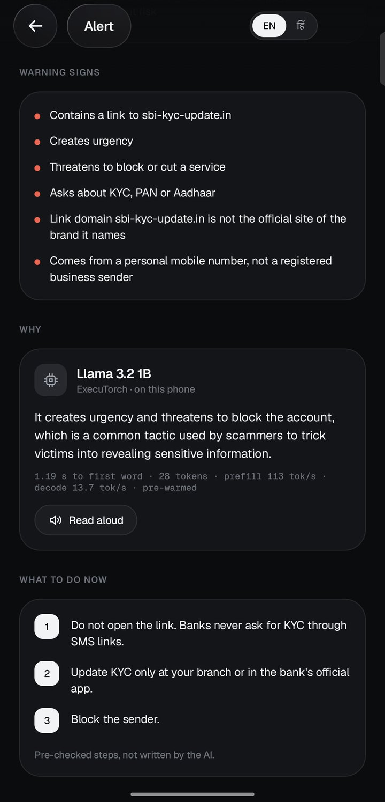
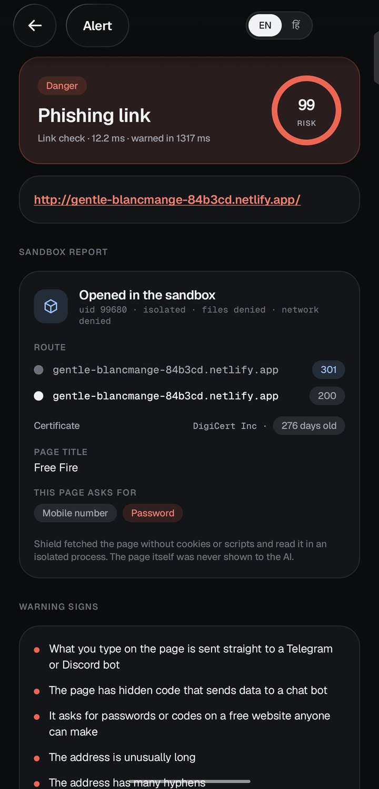
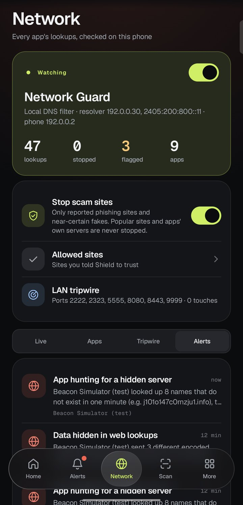
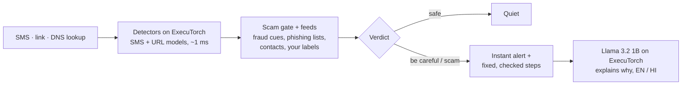

<div align="center">

# ENTITY Shield

**On-device scam, phishing and threat protection for Arm Android phones**

Every SMS, link and app lookup is checked on the phone in milliseconds.<br>
Llama 3.2 1B on ExecuTorch explains each threat in English or Hindi. No cloud, works in airplane mode.

Bharat AI-SoC Challenge 2026–27 · Problem Statement 3 · Team ENTITY

[](../../releases/latest)


[**Download APK**](../../releases/latest) · [**Technical report (PDF)**](docs/report/ENTITY-Shield-Report.pdf) · [**All results**](docs/RESULTS.md) · [**Demo script**](docs/DEMO.md)

</div>

<p align="center">





</p>
<p align="center"><sub>Infinix X6878 (Snapdragon 7s Gen 3). Home · scam SMS explained by Llama · the same alert in Hindi · a link followed in the sandbox · Network Guard.</sub></p>

## At a glance

| | Measured |
|---|---|
| Scam SMS flagged, Indian scam templates **never seen in training** | **93%** (precision 90.5%) |
| When Shield says "scam", it is right | **97%** of the time (1.0% false alarms) |
| Live phishing domains caught by the URL model alone (OpenPhish) | **92%** |
| Real app lookups blocked by mistake by Network Guard | **0.03%** |
| Official Indian bank / UPI / government domains flagged | **0 of 41** |
| SMS check on the phone / SMS in → warning shown | **0.5 ms** / **38 ms** |
| Llama first word in the app (pre-warmed) | **1.0 s** |
| Llama speed over 30 answers back to back | **18.6 → 19.1 tok/s**, no throttling, CPU peak 61 °C |
| App memory at rest / APK size | **164 MB** / **18 MB** |

Every number has a raw file in [`benchmarks/results/`](benchmarks/results) and a script that reproduces it.
Details and caveats: [`docs/RESULTS.md`](docs/RESULTS.md).

## How it works



**Detectors decide, Llama explains.** The verdict and the steps come from the detectors and fixed text.
The app writes the start of Llama's answer, so Llama can't overturn a verdict or invent advice.
More: [`docs/ARCHITECTURE.md`](docs/ARCHITECTURE.md).

## What PS3 asks for, and what runs on the phone

| PS3 requirement | ENTITY Shield | On-device model |
|---|---|---|
| Scam SMS and fraud | Every incoming SMS checked, even with the app closed; inbox audit; learns from "Not a scam" / "Scam" taps | `sms.pte` (ExecuTorch, XNNPACK) + scam gate |
| Phishing URLs | Links in SMS, shared links, **Link Guard**; the **sandbox** follows the link in an isolated process and reports where it lands and what it asks for (OTP, UPI PIN, Aadhaar, card) | `url.pte` + page analysis |
| Network anomalies and intrusions | **Network Guard**: local DNS-only VPN that names the app behind each lookup, blocks known phishing, flags beacons, DGA bursts and DNS tunnelling; **LAN tripwire** for port scans and ADB-worm probes | `url.pte` + behaviour rules |
| Plain-language explanation | Why *this* message is dangerous, streamed, English or Hindi, read aloud, follow-up questions | **Llama 3.2 1B Instruct**, ExecuTorch `LlmModule` |
| Remediation | Fixed steps per scam family + actions: block sender, call 1930, report on cybercrime.gov.in, remove app | Rules (never generated) |
| Local processing | Nothing leaves the phone; message text deletes itself (7 days safe, 30 days alerts) | All on the Arm CPU · [privacy](docs/PRIVACY.md) |

## Quick start

1. Install the APK from the [latest release](../../releases/latest) (Android 10+, arm64):
   `adb install ENTITY-Shield-0.5.2.apk`
2. In the app: **More → On-device AI → Download Llama** (1.1 GB, resumable, SHA-256 checked).
   Detection works without it.
3. **More → Demo scams** → tap a sample: instant verdict, warning signs, then Llama's explanation.
   Switch **EN / हिं** or tap **Read aloud**.
4. **Network** tab → **Turn on Network Guard**. The `beaconsim` test app imitates malware lookups.
5. **More → Always-on protection**: three switches that keep Shield running when the app is closed.

On Android 13+, a sideloaded app may need **App info → ⋮ → Allow restricted settings** before the SMS
permission can be granted.

## Build and reproduce

```bash
uv venv .venv --python 3.12
uv pip install torch==2.14.0 executorch==1.5.1 "torchao>=0.18,<0.19"
bash scripts/download_datasets.sh
python training/train_detector.py sms && python training/train_detector.py url   # train, export .pte, golden vectors
cd android-app && ./gradlew assembleRelease :app:testDebugUnitTest                # app + unit tests
python scripts/e2e_phone.py --serial <id> --install --hindi                       # end-to-end on a phone
```

Each result's script is listed next to it in [`docs/RESULTS.md`](docs/RESULTS.md). Llama export:
`training/llm/export_llama.sh`.

## Limitations

- Network Guard sees this phone's traffic only; Private DNS or an app's own DNS-over-HTTPS bypasses it.
- The URL model sees hostnames only (DNS has no paths): it catches 92% of live OpenPhish domains but
  53% of the older PhishTank time-split set. The sandbox and the phishing list cover more.
- UK-style premium-rate spam (UCI, 2011) is flagged less often (63%) than Indian scams: the gate looks
  for the fraud cues of Indian scams.
- Llama 3.2 1B is wrong 10–15% of the time in manual review, which is why it never decides and never
  writes the steps.

## Repository

| Path | Contents |
|---|---|
| `android-app/app` | The app: `core` (detectors, scam gate, advice), `llm` (Llama), `net` (Network Guard), `sandbox`, `sms`, `ui` |
| `android-app/beaconsim` | Test app that imitates malware DNS behaviour |
| `training/` | Featurizer, detector training and export, Llama export and explanation evaluation |
| `models/detectors/` | Shipped `.pte` detectors, thresholds, DNS lists |
| `scripts/` | End-to-end tests, evaluations and benchmarks |
| `benchmarks/results/` | Raw data behind every number |
| `docs/` | [Results](docs/RESULTS.md) · [architecture](docs/ARCHITECTURE.md) · [privacy](docs/PRIVACY.md) · [demo](docs/DEMO.md) · [plan and log](docs/PLAN.md) · [report](docs/report/ENTITY-Shield-Report.pdf) · [changelog](CHANGELOG.md) |

## Licence and credits

**Created by V S Kamalesh** ([@kkjjkamal123](https://github.com/kkjjkamal123)), Team ENTITY.

Mixed licence ([`LICENSE`](LICENSE)): the detection, network and AI engine, training code, scripts and
docs are Apache-2.0; the app's user interface is proprietary ([`LICENSE-PROPRIETARY.md`](LICENSE-PROPRIETARY.md)).

**Built with Llama.** Llama 3.2 is licensed under the Llama 3.2 Community License, Copyright © Meta
Platforms, Inc. All Rights Reserved. Runtime: ExecuTorch (BSD-3-Clause), XNNPACK, Arm KleidiAI.
Data: UCI SMS Spam Collection (CC BY 4.0), PhishTank, OpenPhish, Tranco, Cisco Umbrella.
See [`THIRD_PARTY_NOTICES.md`](THIRD_PARTY_NOTICES.md).
