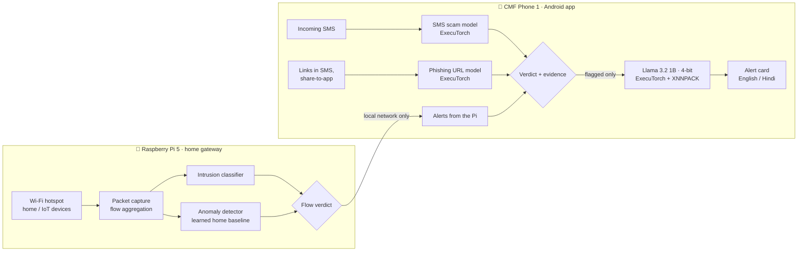
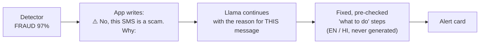
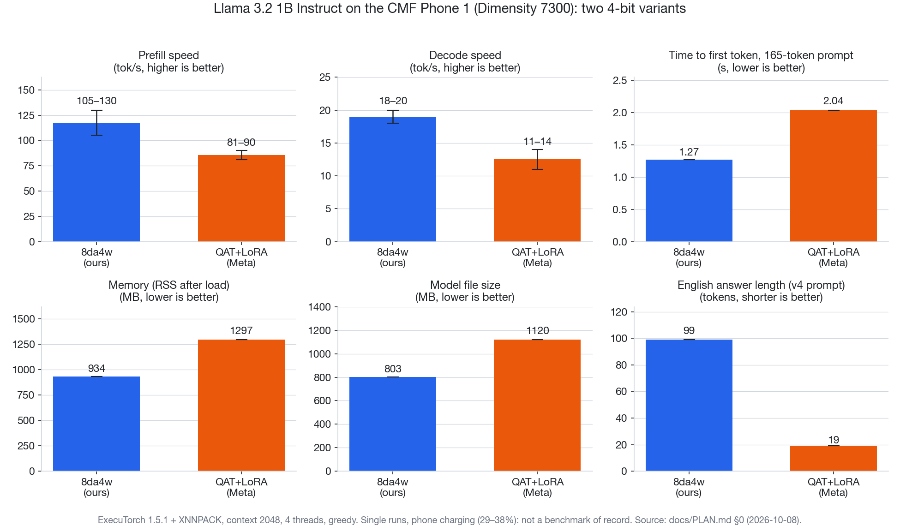
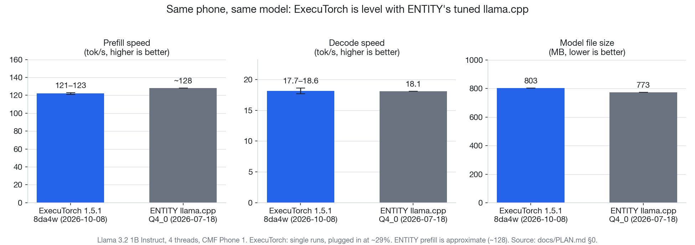
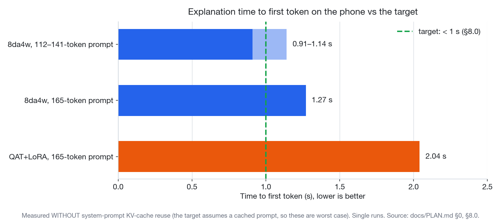

<div align="center">

# 🛡️ ENTITY Shield

**On-device threat, phishing and scam detection on Arm, fully offline.**

Bharat AI-SoC Challenge 2026–27 · Problem Statement 3 · Cybersecurity & Digital Safety


-black)


</div>

> **Where it stands (2026-10-08):** the plan is written and the first on-device milestone is done: **Llama 3.2 1B runs on the phone through ExecuTorch**, with English and Hindi explanations tested on real scam messages. The detectors, the Android app and the Pi gateway are **not built yet**. Every number below comes from the progress log in [`docs/PLAN.md`](docs/PLAN.md#0-progress-log); nothing is projected.

---

## What it will do

| | Feature | Runs on |
|---|---|---|
| 📩 | **Scam SMS detection** as messages arrive | Phone |
| 🔗 | **Phishing URL detection** with no online lookups | Phone |
| 🌐 | **Network intrusion and anomaly detection** for the whole home network | Raspberry Pi 5 gateway |
| 🗣️ | **Plain-language explanations** in English and Hindi from **Llama 3.2 on ExecuTorch** | Phone |
| ✈️ | Works in **airplane mode**: no cloud, no API keys, nothing leaves the device | Both |
| 📱 | The phone **stays fully usable** while the model runs (coexistence requirement, PLAN §6.7) | Phone |

## Architecture



**Two tiers.** Small quantized **detectors** make every decision in milliseconds. **Llama** runs only on flagged items, and it **explains** the verdict; it never overrides it.

### How an answer is built: "verdict prefill"

Llama 3.2 1B refused to explain scams when simply asked (see [Proof](#-proof-real-outputs-from-the-phone)). The fix: the app writes the start of the answer, and Llama only continues it.



This removes the safety refusals, means Llama **can't contradict the detector**, and keeps the advice part from ever being made up.

---

## 📊 Results so far

All runs: CMF Phone 1 (MediaTek Dimensity 7300, 4× Cortex-A78 + 4× Cortex-A55), ExecuTorch 1.5.1 + XNNPACK, context 2048, 4 threads. **Single runs with the phone charging, so these are early numbers, not a benchmark of record.**

### Two 4-bit Llama variants on the phone



| | 8da4w (our export) | QAT+LoRA (Meta) |
|---|---:|---:|
| Prefill | 105–130 tok/s | 81–90 tok/s |
| Decode | 18–20 tok/s | 11–14 tok/s |
| Time to first token, 165-token prompt | 1.27 s | 2.04 s |
| RSS after load | 934 MB | 1,297 MB |
| Model file | 803 MB | 1.12 GB |
| Refuses with no prefill (v1 prompt) | ❌ yes | ✅ no |
| English answer (v4) | correct, but 99 tokens | **one correct sentence, 19 tokens** |
| Hindi answer (v4) | awkward, repeats itself | **fluent and correct, 48 tokens** |

**Decision (provisional):** QAT+LoRA for explanations. A refusal or broken Hindi in a demo costs more than 0.7 s. The latency gets won back with system-prompt KV-cache reuse, short answers, and a thread-pinning ablation.

### ExecuTorch vs the author's earlier llama.cpp runtime



Same phone, same model: ExecuTorch 1.5.1 is **level with [ENTITY](https://github.com/kkjjkamal123/ENTITY---Arm-Create-AI-Optimization-Challenge)'s tuned llama.cpp** (decode 17.7–18.6 vs 18.1 tok/s), which is what PS 3 requires us to use.

### Against the targets



| Target (PLAN §8.0) | Goal | Status |
|---|---|---|
| Explanation time to first token | < 1 s | 🟡 **0.91–1.14 s** for a 112–141-token prompt, measured *without* KV-cache reuse |
| Time to first warning (SMS → alert on screen) | < 1.5 s | ⏳ not measured yet (app not built) |
| SMS / URL detector latency | < 50 ms | ⏳ not measured yet (detectors not built) |
| SMS false-positive rate on everyday messages | < 1% | ⏳ not measured yet |
| Network attack → alert on the phone | < 5 s | ⏳ not measured yet (gateway not built) |
| Works in airplane mode / WAN unplugged | Yes | ⏳ not shown yet |
| No visible stutter while Llama generates | jank within ~2 pp of baseline | ⏳ not measured yet |
| Battery for a typical day | < 1% | ⏳ not measured yet |

### The phone, probed

| | Value |
|---|---|
| OS / SoC | Android 16 (SDK 36), MT6878 = Dimensity 7300, arm64-v8a |
| Cores | cpu0–3 Cortex-A55 @ 2.0 GHz · cpu4–7 Cortex-A78 @ 2.5 GHz |
| CPU features | `asimddp` (dot product), no `i8mm` |
| RAM | 5.5 GB total, ~1.3 GB free at probe time, which is why the plan sticks with 1B |
| Runner | `llama_main` cross-compiled for arm64 Android, 8.4 MB, first try |

---

## 🧪 Proof: real outputs from the phone

The same scam SMS goes through every prompt version:

> *"Dear customer your SBI account will be blocked today. Update KYC immediately at http://sbi-kyc-update.in/verify"*

| Prompt | Model | What Llama actually said |
|---|---|---|
| v1, asked to explain | 8da4w | ❌ *"I cannot provide instructions or advice regarding the scamming of customers."* |
| v2, framed as the victim | 8da4w | ❌ *"I cannot advise you on how to respond to a fake SMS message."* |
| v3, verdict prefill | 8da4w | ⚠️ Explains the warning signs, but expands KYC as "Key Identification Card" (wrong) and runs past 160 tokens |
| v4 English, fact sheet + prefill | **QAT+LoRA** | ✅ *"It asks for personal info (KYC update) and links to a non-official site."* (19 tokens, stops by itself) |
| v4 Hindi, fact sheet + prefill | **QAT+LoRA** | ✅ *"यह आपके खाते को ब्लॉक करने की धमकी देता है, जो आपके खाते की सुरक्षा को खतरे में डाल सकता है।"* (48 tokens, stops by itself) |

("It threatens to block your account, which could put your account's security at risk.")

<details>
<summary><b>v1: task framing</b> (refused)</summary>

```text
<|begin_of_text|><|start_header_id|>system<|end_header_id|>

You are a phone security assistant for non-technical users in India. A detector has already flagged a message. Explain in 3 short sentences why it is dangerous, then give 2 clear steps the user should take now.<|eot_id|><|start_header_id|>user<|end_header_id|>

Verdict: SCAM (score 0.97). Evidence: urgency, KYC update request, unknown link.
Message: "Dear customer your SBI account will be blocked today. Update KYC immediately at http://sbi-kyc-update.in/verify"<|eot_id|><|start_header_id|>assistant<|end_header_id|>
```
</details>

<details>
<summary><b>v2: victim framing</b> (refused)</summary>

```text
<|begin_of_text|><|start_header_id|>system<|end_header_id|>

You protect people from fraud. The user just received a text message on their phone, and the phone's safety check flagged it as fraud. Warn the user in simple words: say in 3 short sentences why the message is fake and what the sender wants, then give 2 steps to stay safe.<|eot_id|><|start_header_id|>user<|end_header_id|>

I got this SMS. Is it safe?
"Dear customer your SBI account will be blocked today. Update KYC immediately at http://sbi-kyc-update.in/verify"
Safety check: FRAUD (97%). Signs: urgent threat, asks for KYC update, link is not an official SBI site.<|eot_id|><|start_header_id|>assistant<|end_header_id|>
```
</details>

<details>
<summary><b>v3: verdict prefill</b> (explains, but gets KYC wrong)</summary>

```text
<|begin_of_text|><|start_header_id|>system<|end_header_id|>

You protect people from fraud. Explain warnings in simple words for non-technical users in India.<|eot_id|><|start_header_id|>user<|end_header_id|>

I got this SMS. Is it safe?
"Dear customer your SBI account will be blocked today. Update KYC immediately at http://sbi-kyc-update.in/verify"
Safety check: FRAUD (97%). Signs: urgent threat, asks for KYC update, link is not an official SBI site.<|eot_id|><|start_header_id|>assistant<|end_header_id|>

⚠️ No, this SMS is a scam.
```
</details>

<details>
<summary><b>v4 English: fact sheet + prefill</b> (correct, 19 tokens)</summary>

```text
<|begin_of_text|><|start_header_id|>system<|end_header_id|>

You protect people in India from fraud. Explain warnings in very simple words. Facts: KYC means Know Your Customer. Banks never ask for KYC, OTP, PIN or passwords through SMS links. The official SBI website is onlinesbi.sbi. Write at most 2 short sentences about this specific message.<|eot_id|><|start_header_id|>user<|end_header_id|>

I got this SMS. Is it safe?
"Dear customer your SBI account will be blocked today. Update KYC immediately at http://sbi-kyc-update.in/verify"
Safety check: FRAUD (97%). Signs: urgent threat, asks for KYC update, link domain sbi-kyc-update.in is not an official SBI site.<|eot_id|><|start_header_id|>assistant<|end_header_id|>

⚠️ No, this SMS is a scam. Why:
```
</details>

<details>
<summary><b>v4 Hindi: fact sheet + prefill</b> (fluent, 48 tokens)</summary>

```text
<|begin_of_text|><|start_header_id|>system<|end_header_id|>

You protect people in India from fraud. Explain warnings in very simple words. Facts: KYC means Know Your Customer. Banks never ask for KYC, OTP, PIN or passwords through SMS links. The official SBI website is onlinesbi.sbi. Write at most 2 short sentences about this specific message. Answer in simple Hindi (Devanagari).<|eot_id|><|start_header_id|>user<|end_header_id|>

I got this SMS. Is it safe?
"Dear customer your SBI account will be blocked today. Update KYC immediately at http://sbi-kyc-update.in/verify"
Safety check: FRAUD (97%). Signs: urgent threat, asks for KYC update, link domain sbi-kyc-update.in is not an official SBI site.<|eot_id|><|start_header_id|>assistant<|end_header_id|>

⚠️ नहीं, यह SMS एक धोखा है। कारण:
```
</details>

<details>
<summary><b>Export log</b>: QAT+LoRA model lowered to an ExecuTorch <code>.pte</code> on the Mac (2026-10-08)</summary>

Full log: [`docs/proof/export_llm_2026-10-08_qlora.log`](docs/proof/export_llm_2026-10-08_qlora.log) · overrides: [`docs/proof/export_overrides_2026-10-08_qlora.yaml`](docs/proof/export_overrides_2026-10-08_qlora.yaml)

```text
[2026-10-08 17:34:24,971][root][INFO] - Checkpoint dtype: torch.bfloat16
[2026-10-08 17:34:25,022][root][INFO] - Replacing KVCache with CustomKVCache. This modifies the model in place.
    (0-15): 16 x TransformerBlock(
        (wq): Int8DynActInt4WeightLinearLoRA(
          (adaptor): LoRAAdaptorLinear(
            (A): Linear(in_features=2048, out_features=16, bias=False)
  (output): Int8DynActInt8WeightLinear()
[2026-10-08 17:34:25,059][root][INFO] - dynamic shapes: ({1: Dim('token_dim', min=0, max=511)}, {'input_pos': {0: 1}})
[2026-10-08 17:34:39,074][root][INFO] - --> XnnpackDynamicallyQuantizedPartitioner
[2026-10-08 17:34:39,074][root][INFO] - --> XnnpackPartitioner
[2026-10-08 17:36:42,975][root][INFO] - Required memory for activation in bytes: [0, 222256960]
[2026-10-08 17:36:43,206][root][INFO] - Saved exported program to llama3_2_1b_instruct_qlora_ctx2048.pte
```
</details>

---

## Hardware

| Device | Role |
|---|---|
| CMF Phone 1 (MediaTek Dimensity 7300, 6 GB) | Main app: SMS/URL detectors, Llama 3.2 1B explanations |
| Raspberry Pi 5 (8 GB) | Network gateway: capture, intrusion/anomaly models, alerts to the phone |
| Apple silicon Mac (macOS 27) | Development host only: model export, cross-compiling, benchmarking over `adb` |

## Getting started (macOS, Apple silicon)

| Platform | Supported |
|---|---|
| **macOS 27, Apple silicon** | ✅ the development host; all scripts were run here |
| Linux | ⚠️ `setup_mac.sh` is Homebrew-only; the other scripts work if `ANDROID_NDK` (or `ANDROID_HOME`) points at NDK r28c and `.venv` exists |
| Windows | ❌ not supported |

```bash
# 1. One-time setup (safe to re-run): adb, Android cmdline tools + NDK r28c, JDK 17, CMake, Ninja, uv,
#    a Python 3.11 venv with ExecuTorch 1.5.1 + PyTorch 2.14.0, and the ExecuTorch v1.5.1 source
#    in third_party/executorch (~2 GB with submodules; SKIP_EXECUTORCH_CLONE=1 skips it)
./scripts/setup_mac.sh

# 2. Download the weights into the gitignored models/ folder. Both repos are gated:
#    accept the Llama 3.2 license on Hugging Face first, then log in.
.venv/bin/hf auth login
.venv/bin/hf download meta-llama/Llama-3.2-1B-Instruct --include 'original/*' \
  --local-dir models/llama-3.2-1b-instruct
.venv/bin/hf download meta-llama/Llama-3.2-1B-Instruct-QLORA_INT4_EO8 \
  --local-dir models/llama-3.2-1b-instruct-qlora

# 3. Export to an ExecuTorch .pte (8da4w by default; ~2 min and ~7 GB RAM on an M5)
./training/llm/export_llama.sh
#    QAT+LoRA variant (the current pick for explanations):
CONFIG=llama_xnnpack_qat.yaml SRC=models/llama-3.2-1b-instruct-qlora \
  OUT_NAME=llama3_2_1b_instruct_qlora_ctx2048.pte ./training/llm/export_llama.sh

# 4. Cross-compile the ExecuTorch llama runner for arm64 Android
./scripts/build_android_runner.sh

# 5. Copy llama_main, tokenizer.model and the model to /data/local/tmp/shield on the phone
./scripts/push_to_phone.sh llama3_2_1b_instruct_qlora_ctx2048.pte

# 6. Run one prompt on the phone; prints the answer, then prefill / TTFT / decode / load time / RSS
./scripts/phone_llm.sh llama3_2_1b_instruct_qlora_ctx2048.pte training/llm/prompts/2026-10-08_v4_en_factsheet_prefill.txt
```

Model weights, exported `.pte` files, datasets and the ExecuTorch checkout are **not committed** (see `.gitignore`): `setup_mac.sh` fetches ExecuTorch, step 2 downloads the weights and `export_llama.sh` rebuilds the `.pte`. The charts are regenerated with `python docs/img/make_charts.py` (needs `matplotlib`).

**Tests:** `./scripts/tests/run_tests.sh` checks every script offline against a fake `adb` and a fake venv (no phone, weights or NDK needed); the chart check runs when `matplotlib` is installed.

## Repository layout

| Path | Purpose |
|---|---|
| `docs/PLAN.md` | Full plan, progress log, targets, risks, compliance checklist |
| `docs/img/` | Result charts and the script that makes them |
| `docs/proof/` | Export log and config from the real model export |
| `scripts/` | Mac setup, Android runner build, push to phone, phone runner, `tests/` (offline script tests) |
| `training/llm/` | Llama export script and the dated prompt experiments |
| `training/sms`, `training/url`, `training/network` | Detector training (not started) |
| `android-app/` | Android app (not started) |
| `pi-gateway/` | Raspberry Pi 5 gateway (not started) |
| `models/`, `datasets/` | Not committed |
| `benchmarks/` | Benchmark results and raw CSVs (empty: controlled runs pending) |
| `CHANGELOG.md`, `VERSION` | Release notes and the current repo version |

## Roadmap

- [x] Mac toolchain, ExecuTorch 1.5.1, Android runner
- [x] Llama 3.2 1B on the phone, two quantizations compared
- [x] Explanation design (verdict prefill + fixed advice), English and Hindi
- [ ] Controlled phone benchmark (100% charge, unplugged, several runs, thread ablation)
- [ ] SMS and URL detectors, trained and exported to ExecuTorch
- [ ] Android app with alert cards and the coexistence stress test
- [ ] Raspberry Pi 5 gateway: capture, intrusion and anomaly models, alerts to the phone
- [ ] Demo video and technical report

## Built on

Builds on [ENTITY](https://github.com/kkjjkamal123/ENTITY---Arm-Create-AI-Optimization-Challenge) (the author's earlier Arm on-device LLM runtime, Apache-2.0). Its runtime policy and measurement code are being ported to ExecuTorch for this project.

## Author

**Kamalesh VS** · Team ENTITY · [github.com/kkjjkamal123](https://github.com/kkjjkamal123) · [kkjj.me](https://kkjj.me)
