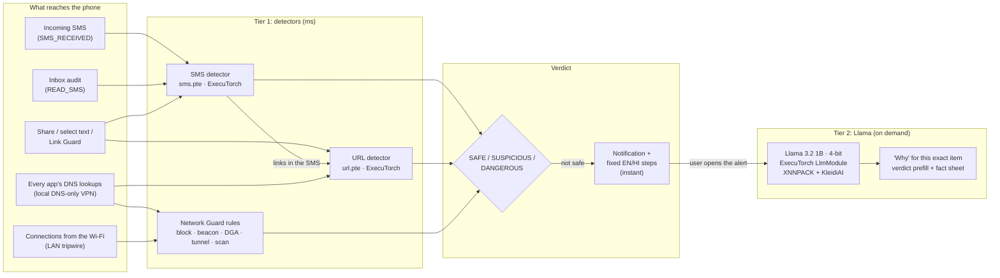
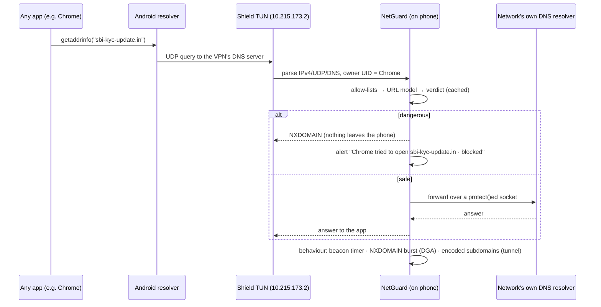

# Architecture

ENTITY Shield runs entirely on one Arm Android phone. Two tiers:

1. **Detectors decide**, in milliseconds, on every message, link and network event: two ExecuTorch
   models (SMS and URL) plus Network Guard's behaviour rules.
2. **Llama explains**, only for flagged items, and only the *why*. The verdict and the "what to do"
   steps are never generated, so the language model cannot overturn a decision or invent advice.

## Detectors (`training/`, `android-app/.../Detectors.kt`, `Featurizer.kt`)

- **Features:** hashed character 2–5-grams (32,768 slots, FNV-1a, log counts, L2-normalised) plus named
  0/1 signals: urgency, asks for OTP/PIN, payment request, account threat, prize, job/task, authority
  threat, KYC/Aadhaar, link present, brand-vs-domain mismatch, shortener, **sender is a 10-digit mobile
  number vs a registered DLT header** (`VM-HDFCBK`), "do not share", call-this-number. URL model: the
  hostname's n-grams plus IP host, punycode, subdomain depth, length, digits, hyphens, cheap TLD,
  shortener, free hosting, brand-not-official, lure words.
- **Model:** logistic regression, trained as an `EmbeddingBag` on sparse input and exported as one dense
  `Linear + sigmoid` to an ExecuTorch `.pte` (XNNPACK), 130 KB each.
- **Same code on both sides:** `Featurizer.kt` is a line-by-line port of `training/featurize.py`. Golden
  vectors (`training/*/golden.json`) are checked three times: in Python at export, on the JVM
  (`FeaturizerTest`), and on the phone (Lab → Bench / self-test) through the production path.
- **Production path:** an allocation-free featurizer (`hashedSparse`) writes only the touched slots into
  one direct `FloatBuffer` per model, wrapped once as an ExecuTorch `Tensor` (no copy per message).
- **Bands:** thresholds chosen on the validation split for ≤ 1% false alarms (`scam`) and ≤ 5%
  (`uncertain`). Allow-lists come first for URLs: official Indian brand domains + Tranco top 10k, minus
  shared platforms that phishers use.

## Network Guard (`ShieldVpnService.kt`, `NetGuard.kt`, `DnsPacket.kt`, `Tripwire.kt`)

- **DNS-only VPN:** only the fake resolver address is routed into the TUN, so app traffic never passes
  through Shield. Shield excludes itself from its own VPN, so its forwarding sockets go straight to the
  real network.
- **Per-app attribution:** `ConnectivityManager.getConnectionOwnerUid()` (Android 10+, VPN owner only).
- **Behaviour detectors:**
  - **Beacon:** the same app hits one non-allow-listed domain at least 6 times at a near-constant
    interval (coefficient of variation under 0.25).
  - **DGA burst:** at least 8 different non-existent names from one app within 60 s.
  - **Tunnel:** at least 15 unique subdomains under one domain within 60 s, or at least 3 long,
    high-entropy labels.
- **LAN tripwire:** listens on decoy high ports (2222, 2323, 5555, 8080, 8443, 9999). A phone has no
  reason to receive connections there, so it alerts on any of these:
  - one IP touching 3 or more ports within 30 s (scan);
  - 5 or more connections to one port within a minute (password guessing);
  - any touch of 5555 (ADB-worm probe).
- **Limits (stated, not hidden):**
  - Network Guard sees this phone's own traffic, not other devices on the network.
  - Strict Private DNS (DoT to a named host) or in-app DoH bypasses the DNS view.
  - Android allows one VPN at a time.

## Llama on ExecuTorch (`Explainer.kt`, `Advice.kt`, `training/llm/`)

- **Model:** Llama 3.2 1B Instruct, Meta's quantization-aware-trained `QLORA_INT4_EO8` checkpoint
  exported with ExecuTorch 1.5.1 (XNNPACK, 4-bit weights / 8-bit dynamic activations, KV cache, custom
  SDPA, context 2048), 1.12 GB. Our own 8da4w export (803 MB, faster but weaker in Hindi) is the
  low-RAM fallback.
- **Answer = verdict prefill + fact sheet:** the app writes the start of the answer ("⚠️ No, this SMS is
  a scam. Why:") and a short fact sheet (KYC = Know Your Customer, UPI PIN only sends money, 1930).
  Llama continues with 1–2 sentences about *this* message. Without the prefill, the 1B refused to
  explain scams at all (`training/llm/prompts/2026-10-08_v1`).
- **Runs when the user looks:** the notification and the fixed steps appear instantly. The
  explanation streams in the alert screen. The model loads on demand and unloads after 90 s idle.
- **Pre-warm:** when an alert fires, the fixed system prompt is pre-filled into the KV cache (ExecuTorch
  `prefillPrompt`), so the explanation pays only for the message-specific tokens.
- **Thread placement (measured):** a `THREAD_PRIORITY_BACKGROUND` thread is moved by Android to
  `cpuset:/background`. ExecuTorch's XNNPACK workers inherit it and the model runs on the Cortex-A55s:
  prefill 25 tok/s instead of ~85. Explanations therefore run at normal priority, while the user is
  looking at the alert.

## Coexistence rules

1. Detection never waits for Llama (separate thread and queue).
2. Llama loads on demand and frees its ~1.3 GB after 90 s idle.
3. Llama runs only while an alert is on screen, never in the background path.
4. If free RAM is tight, the 8da4w model (934 MB RSS) is used.
5. The cost is measured, not assumed (Lab → Bench, `scripts/bench_threads.py`).
