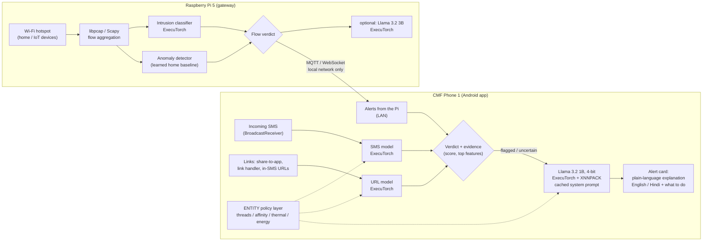

# ENTITY Shield — Project Plan

> Bharat AI-SoC Challenge 2026–27 · Problem Statement 3 · On-device threat, phishing and scam detection
>
> Working name: **ENTITY Shield**. Status: **building: week 1, phone first.** Last updated 2026-10-08.
>
> **Now:** Llama 3.2 1B runs on the CMF Phone 1 through ExecuTorch. **Meta's QAT+LoRA 1B is the explanation-model candidate** (no refusals, fluent Hindi) but ~35% slower than our own 4-bit export; next: controlled benchmark + system-prompt cache to win the latency back. See [Progress log](#0-progress-log).

---

## Contents

0. [Progress log](#0-progress-log)
1. [The challenge](#1-the-challenge)
2. [Timeline](#2-timeline)
3. [What we start with](#3-what-we-start-with)
4. [Hardware and roles](#4-hardware-and-roles)
5. [System architecture](#5-system-architecture)
6. [Components in detail](#6-components-in-detail)
7. [Design decisions and why](#7-design-decisions-and-why)
8. [Evaluation and evidence plan](#8-evaluation-and-evidence-plan)
9. [Week-by-week plan to Phase 1](#9-week-by-week-plan-to-phase-1)
10. [Phase 2 outlook](#10-phase-2-outlook)
11. [Risks and mitigations](#11-risks-and-mitigations)
12. [Compliance checklist](#12-compliance-checklist)
13. [Repository layout](#13-repository-layout)
14. [Open questions](#14-open-questions)
15. [References](#15-references)

---

## 0. Progress log

Newest first.

### 2026-10-08 (night): coexistence requirement added

**Requirement (from the user):** everything must keep working, and the phone must stay fully usable, while the model runs. Documented as **§6.7** (what runs when + 5 rules), with targets in **§8.0** and a **"normal use" stress test** in **§8.2**.

**Also decided (discussion, 2026-10-08):** running locally is mandatory under PS 3 (no cloud LLM), so the work is to make local good. Levers, in order of impact: (1) Llama only on flagged items, detection never waits for it; (2) **distillation**: a bigger Llama writes high-quality EN/HI explanations at *training* time, and the 1B is LoRA-fine-tuned on them (check the Llama license terms for training on Llama outputs first); (3) pre-written, checked explanations per scam family, with Llama adding only the message-specific part; (4) system-prompt KV-cache reuse; (5) GPU (Vulkan) / MediaTek NPU backends as optional experiments.

### 2026-10-08 (late): two Llama 1B variants compared, Hindi tested

**New tooling:** `scripts/phone_llm.sh <model.pte> <prompt file> [max_new] [threads]` runs one prompt on the phone and prints the answer plus prefill / TTFT / decode. `training/llm/export_llama.sh` now takes `CONFIG`, `SRC`, `OUT_NAME` (and uses Hydra's `++` override syntax; `+` fails when the config already sets a key, e.g. `export.max_seq_length` in the QAT config).

**Models compared** (both Llama 3.2 1B Instruct, XNNPACK, context 2048, prefill chunk 512):

- **8da4w (ours):** Meta's bf16 checkpoint, post-training quantized: 8-bit dynamic activations + 4-bit weights (group 128), 4-bit embeddings. 803 MB.
- **QAT+LoRA (Meta's):** `meta-llama/Llama-3.2-1B-Instruct-QLORA_INT4_EO8`, quantization-aware trained + LoRA rank 16: 4-bit weights (group 32), **8-bit embeddings and 8-bit output layer**. Export config `llama_xnnpack_qat.yaml`. 1.12 GB.

**Prompts:** v1 (no prefill), v4 English and v4 Hindi (fact sheet in the system prompt + verdict prefill; `training/llm/prompts/2026-10-08_v4_*`). Greedy, 4 threads, max 100 new tokens.

| | 8da4w (ours) | QAT+LoRA (Meta) |
|---|---|---|
| v1, no verdict prefill | ❌ refuses | ✅ explains + "Steps to take now" (no refusal) |
| v4 English | ✅ correct (KYC = Know Your Customer, thanks to the fact sheet) but verbose: 3 points + extra, 99 tokens | ✅ **one correct sentence, stops by itself** (19 tokens): "It asks for personal info (KYC update) and links to a non-official site." |
| v4 **Hindi** | ❌ awkward, vague, **repeats itself** | ✅ **fluent and correct, stops by itself** (48 tokens): "यह आपके खाते को ब्लॉक करने की धमकी देता है, जो आपके खाते की सुरक्षा को खतरे में डाल सकता है।" |
| Prefill | 105–130 tok/s | 81–90 tok/s |
| Decode | 18–20 tok/s | 11–14 tok/s |
| TTFT, 165-token prompt | 1.27 s | 2.04 s |
| RSS after load | 934 MB | 1,297 MB |

**Why QAT+LoRA is slower:** 8-bit embeddings and an 8-bit 128k-vocabulary output layer mean more bytes per token, and decode on this phone is bandwidth-bound (ENTITY's finding). Group size 32 instead of 128 also adds scale overhead.

**Caveats:** single runs; phone charging (29–38%); QAT runs came after the 8da4w runs (warmer phone); one earlier run of the 8da4w model dropped to 8.3 tok/s decode, so variance is high under these conditions. **Not a benchmark of record.**

**Decision (provisional, pending the controlled benchmark):** **QAT+LoRA for explanations.** A refusal or broken Hindi in a demo costs more than 0.7 s. Win the latency back with (1) system-prompt KV-cache reuse (about half of the prompt is fixed), (2) short answers (it stops at 19–48 tokens on its own), (3) the thread/pinning ablation.

**Answer design (decided):** ⚠️ **verdict** (written by the app from the detector) → **why** (Llama, about this specific message: lookalike domain, the trick used) → **what to do** (**fixed, pre-checked text** per scam type in English and Hindi: never generated, so it can't be wrong). Llama also handles follow-up questions ("I already clicked, what now?"), languages and network-alert explanations, so it does real work rather than decoration.

**Not allowed by PS 3 (asked 2026-10-08):** a non-Llama model (Gemma, Qwen, Phi) for the advisory part; Apple Intelligence (macOS/iOS are not listed hardware, and the model isn't Llama). Apple's on-device model can still be a development tool on the Mac (e.g. drafting English test messages); check Apple's terms before using its output as training data.

### 2026-10-08 (evening): first Llama 3.2 1B run on the phone ✅

**Model:** Llama 3.2 1B Instruct (Meta `original/` checkpoint) → `training/llm/export_llama.sh` → `models/llama3_2_1b_instruct_8da4w_ctx2048.pte`: XNNPACK, 8da4w (group 128), 4-bit embeddings (group 32), KV cache + custom SDPA, context 2048, prefill chunk 512. **803 MB** (ENTITY's Q4_0 GGUF: 773 MB). Export: 130 s on the M5, 6.8 GB peak RAM.

**Preliminary numbers** (4 threads, phone **plugged in at ~29%**, screen on, single runs: not yet a benchmark of record):

| | ExecuTorch 1.5.1 (today) | ENTITY llama.cpp Q4_0 (2026-07-18) |
|---|---:|---:|
| Prefill | 121–123 tok/s | ~128 tok/s |
| Decode | 17.7–18.6 tok/s | 18.1 tok/s |
| Time to first token, 112–141-token prompt | **0.91–1.14 s** | — |
| RSS after load | 934 MB | — |
| Model load | 1.8–2.1 s | — |

So ExecuTorch on this phone is level with ENTITY's tuned llama.cpp, and the sub-1-second explanation target is already met for a ~110-token prompt, before any KV-cache reuse.

**Explanation behaviour** (prompts in `training/llm/prompts/`, greedy decoding):

| Prompt | Result |
|---|---|
| v1: system prompt asks to explain why a flagged message is dangerous | ❌ **Refused:** "I cannot provide instructions or advice regarding the scamming of customers." |
| v2: framed from the victim's side ("I got this SMS. Is it safe?") | ❌ **Refused:** "I cannot advise you on how to respond to a fake SMS message." |
| v3: **verdict prefill**: the app writes the start of the answer ("⚠️ No, this SMS is a scam.") and Llama continues | ✅ Explains the warning signs correctly in structure, **but** expands KYC as "Key Identification Card" (wrong: Know Your Customer) and runs past 160 tokens without reaching the "what to do" steps |

**Decision: verdict prefill is the explanation design.** The detector's verdict is written by the app into the first sentence of the answer, and Llama only continues it. This avoids the safety refusal and also guarantees Llama can't contradict the verdict (faithfulness, §6.4).

**Next for quality:** fixed short output shape (≤ 2 lines why + 2 steps, ~60–80 tokens); remediation steps first; a small fact sheet in the prompt (KYC, UPI, 1930) to stop wrong expansions; then LoRA fine-tuning (§6.4) if prompt work isn't enough, especially for Hindi.

**Benchmark caveat:** the runner logged `Failed to open midr file` and fell back to its own core count (4 "efficient" cores detected). Check which cores the 4 threads actually land on during the thread ablation.

### 2026-10-08: phone first, toolchain and ExecuTorch runner

**Decision:** start with the **phone as the demo**: the CMF Phone 1 is the core product ("movable" mode, §6.6), and the Pi gateway comes later.

**Done**

- [x] Mac toolchain installed and scripted in `scripts/setup_mac.sh`: `adb`, Android command-line tools, **NDK r28c** (`28.2.13676358`), JDK 17, CMake, Ninja, uv, Python 3.11 venv (`.venv`) with **ExecuTorch 1.5.1** + **PyTorch 2.14.0** (MPS available)
- [x] ExecuTorch **v1.5.1** source in `third_party/executorch` (gitignored)
- [x] `llama_main` cross-compiled for arm64 Android with XNNPACK + optimized/quantized/LLM kernels: `scripts/build_android_runner.sh` (first try, 8.4 MB binary)
- [x] Runner pushed to `/data/local/tmp/shield/` on the phone and confirmed working. It has a `-cpu_threads` flag, so ENTITY's thread ablation can be repeated on ExecuTorch
- [x] Phone connected over USB and authorized for `adb`

**Phone probe (CMF Phone 1)**

| | Value | Implication |
|---|---|---|
| OS / SoC | Android 16 (SDK 36), MT6878 = Dimensity 7300, arm64-v8a | As planned |
| Cores | cpu0–3: 2.0 GHz (Cortex-A55) · cpu4–7: 2.5 GHz (Cortex-A78) | Same 4+4 layout as ENTITY's record |
| CPU features | `asimddp` (dotprod), **no `i8mm`** | KleidiAI's dotprod path, not i8mm |
| RAM | 5.5 GB total, **~1.3 GB available** at probe time | Tight for Llama 1B (~1–1.5 GB); close apps before benchmarks; keep 1B, not 3B |
| Storage | **8.1 GB free (93% full)** | Enough for one model; free space before adding more |
| Battery | 22% at probe | Charge fully before unplugged benchmarks |

**Gotchas hit (recorded so they don't cost time again)**

- `yes | sdkmanager --licenses` under `set -o pipefail` exits 141 (SIGPIPE) and aborts the script → `|| true`
- The `executorch` 1.5.1 wheel **does not depend on `torch`**: install the version from its `torch_pin.py` (**2.14.0**) explicitly
- `huggingface_hub` 2.x no longer has a `[cli]` extra; the `hf` CLI comes with the base package
- `sdkmanager` now prints a deprecation warning (replacement: `android sdk`). It still works

**Blocked**

- [x] ~~Llama 3.2 1B Instruct access~~: approved the same day; weights downloaded

**Next**

1. Download `original/` (consolidated.00.pth, params.json, tokenizer.model) → `models/llama-3.2-1b-instruct/`
2. Export with `executorch.extension.llm.export.export_llm`: XNNPACK, `8da4w`, KV cache + SDPA, shared 4-bit embeddings
3. Push the `.pte` + tokenizer, run on the phone; record TTFT and decode tok/s (unplugged, screen state stated, several runs; ENTITY + Voxel protocol)
4. Thread ablation on ExecuTorch: 8 threads vs 4 vs 4 pinned to the A78s; compare with ENTITY's llama.cpp record (decode 18.1 tok/s, prompt ~128 tok/s)

**Housekeeping**

- [ ] Revoke the Hugging Face token pasted into chat on 2026-10-08 (it's now in the session log and the Obsidian sync); use `! .venv/bin/hf auth login` for a fresh one
- [ ] Revoke the GitHub token found in the Obsidian vault (session note from 2026-09-29)
- [ ] Register the team by **19 Oct**

---

## 1. The challenge

**Source:** <https://arm-education.github.io/Arm-Developer-Labs/Bharat_AI_SoC_2026_27.html>

**Problem Statement 3 — On-Device Threat, Phishing & Scam Detection** (theme: Cybersecurity & Digital Safety).

Official objective: *"Develop an on-device AI system that detects cybersecurity threats, including network intrusions, malware behaviour and phishing or scam communications, running entirely on Arm-based edge hardware without cloud dependency."*

### Required capabilities

| # | Capability | Covered by |
|---|---|---|
| C1 | Monitor and classify network traffic for anomalies and intrusions | Pi 5 gateway: flow intrusion detection model plus anomaly detector |
| C2 | Detect phishing URLs | Phone: URL model |
| C3 | Detect scam SMS and fraudulent communications | Phone: SMS model |
| C4 | Explain threats to non-expert users in plain language | Llama 3.2 on ExecuTorch, English and Hindi |
| C5 | **Recommend remediation actions** | Llama 3.2 "what to do now" steps, plus one-tap actions in the app (block sender, don't open link, report to 1930 / cybercrime.gov.in, isolate a device on the Pi) |
| C6 | Process data locally, no cloud dependency | Every model runs on the device; the app has no internet permission |

Malware behaviour is named in the objective but not in the capability list. We cover it through network behaviour: an infected device beaconing to a command server, scanning, or uploading unusual amounts of data shows up in the Pi's anomaly detection.

### Required technology

- **A Llama-family model**
- **ExecuTorch** as the runtime for on-device deployment

Exact wording: *"A model from the Llama family must be used for the advisory or reasoning component and deployed on-device using ExecuTorch as the reference runtime."* So Llama is required for the advice/reasoning part. The detectors don't have to be Llama.

Hailo note from the organisers: if a Hailo NPU is used, it runs through HailoRT while Llama runs through ExecuTorch on the Pi's CPU. These are separate pipelines and must be documented clearly.

### Optional technology (named by the organisers)

- Datasets: **CICIDS**, **UNSW-NB15**, **NSL-KDD**, **PhishTank / OpenPhish** feeds, **UCI SMS Spam Collection**
- Packet capture: **libpcap**, **Scapy**
- **Hailo SDK** (for the Pi AI HAT+; we don't have one)

### Supported hardware

Arm Android phones, Raspberry Pi 5 (CPU only or with AI HAT+ / AI HAT+ 2), other Arm Linux devices.

### Deliverables

Source code (GitHub), a working application, a demo video, a technical report.

### Rules that affect us

- Only the **team leader** registers the team.
- The project must be **hosted on GitHub**.
- Each team picks **one** problem statement.
- The team or the problem statement can be changed **once**, within 15 days of registering.
- Eligibility: Indian nationals; teams of 1–3. Student teams must come from one college and need a faculty mentor. Professional teams must come from one organisation.
- Judging: Phase 1 (open qualifying) produces a shortlist, which goes on to Phase 2 (proof of concept). Finals are live virtual demos with jury Q&A. One winner per problem statement. Cash awards come from IIT Delhi.

---

## 2. Timeline

Today is **Monday 2026-10-05**.

| Milestone | Date | Notes |
|---|---|---|
| Challenge launch | 2026-09-19 | |
| **Registration closes** | **2026-10-19** | Register in week 1. Don't leave it to the deadline. |
| **Phase 1 submission** | **2026-11-30** | About 8 weeks away |
| Phase 1 results | mid-December 2026 | |
| Phase 2 submission | 2027-02-10 | |
| Finals and winners | early March 2027 | Live demo plus jury Q&A |

---

## 3. What we start with

### 3.1 ENTITY (Arm Create AI Optimization Challenge)

Repo: <https://github.com/kkjjkamal123/ENTITY---Arm-Create-AI-Optimization-Challenge> (Apache-2.0)

An offline Android LLM app: a Kotlin front end and a C++ JNI layer over **llama.cpp / GGUF**, with KleidiAI.

**Measured on the CMF Phone 1 (Dimensity 7300), our target phone:**

| Model | Decode | Prefill | Notes |
|---|---:|---:|---|
| Llama 3.2 1B Q4_0, ENTITY Auto | ~18 tok/s | ~128 tok/s | TTFT ~4 s at a 512-token prompt |
| Llama 3.2 3B Q4_0 | ~6–7 tok/s | — | Too slow for interactive alerts |

**Reusable pieces, which don't depend on the runtime:**

| ENTITY component | Reuse in Shield |
|---|---|
| `DeviceProbe.kt`, `DeviceOptimizer.kt`: per-core frequency and capacity probing, fast-core ranking, thread count, affinity | Thread and affinity policy for ExecuTorch / XNNPACK |
| Thermal guard, ADPF hint session | Sustained scanning without throttling |
| `PowerMath.kt`: battery current and voltage sampling, J and tok/W | **Energy per scan** metric |
| Benchmark activity, ablation arms, CSV export, history | Benchmarks for the detectors and the explanation step |
| `ModelCatalog.kt` RAM-fit logic (ROOMY / TIGHT / NO) | Choosing 1B or 3B at runtime |
| KV-session reuse (v12) | Reuse the system-prompt KV cache across alerts to cut TTFT (has to be rebuilt for ExecuTorch) |
| Markdown rendering, theming, UI parts | App UI |
| Evidence style: `LEDGER.md`, `JOURNEY.md`, known limitations, raw CSVs | Same documentation discipline here |
| `benchmarks/COMPARISONS.md` rules for a fair ExecuTorch comparison | Cross-runtime ablation |

**Gap:** ENTITY runs on **llama.cpp**, but PS 3 requires **ExecuTorch**. The Llama model in the shipped product must run on ExecuTorch. llama.cpp may appear **only as a comparison baseline** in the report.

### 3.2 Bharat AI-SoC 2026 entry (road anomaly detection)

Repo: <https://github.com/kkjjkamal123/ARM-Bharath-Challenge-2026>

YOLOv8n-OBB, INT8 TFLite with XNNPACK on the **Raspberry Pi 5**: 43.6 FPS, ~10 ms latency, mAP50 0.982. Gives us Pi 5 deployment and INT8 quantization experience for the gateway.

### 3.3 Lessons from ENTITY's Arm Create judging

From the competitor and judging analysis in the Obsidian notes (`ClaudeVault/Sessions/ARM/`, August 2026):

| What happened with ENTITY | What it means for Shield |
|---|---|
| ENTITY's real edge was its rigor (self-falsifying ledger, equivalence lab, crowd-sourced data), not its optimizations; ≥7–9 other entries found the same KleidiAI and thread-count results | Make Shield's novelty a **product** that no one else has (offline Hindi scam explanations, 4-device guard), and keep the rigor as support |
| The headline looked small: "+47%" next to other entries' "11×" | Lead with one **concrete, repeatable headline**, e.g. *"Catches the scam SMS and explains it in Hindi in under a second, with the phone in airplane mode"* |
| UX/DX was the weakest column: broken LaTeX on the write-up page, very long write-ups | A **60-second quick start** for judges (install the APK, send a test SMS, see the alert); a short README up front with the depth behind links; check every page renders |
| The panel was mostly DevRel / evangelists, who reward a story they can repeat and something reproducible without special hardware | The Bharat jury is different (live demo + Q&A, IIT Delhi), but the same rule holds: **demo first, depth on request**. Have a phone-only mode that works without the Pi |

### 3.4 Lessons from the Arm Create 2026 winner (Voxel)

Repo: <https://github.com/anudit/armcreate> (Mobile AI track, Pixel 8). A from-scratch Rust INT8 engine that reads each core's **MIDR** and splits work by core capability instead of evenly.

| What Voxel did | What we take from it |
|---|---|
| **One thesis in the title:** "dispatching on microarchitecture, not just ISA" | Shield's README opens with one sentence a judge can repeat |
| **A user-facing headline metric:** "time to first action" (0.54 s), not tok/s | Our headline metric: **time to first warning** (SMS arrives → alert with explanation on screen) |
| **The demo ends in a real action:** "set an alarm for 7am" fires an actual Android intent | Our demo ends in **real remediation**, not just text: sender blocked; the Pi actually cuts off the infected device (firewall drop) |
| **README leads with a "What we won" table**, then a "How close we are" table where they lose (prefill 7.4× slower than llama.cpp), then "What didn't work" | Same structure; ~200 lines, not 400 |
| **Counterintuitive measured findings** (the A715 cluster beats the X3 prime core at 9.4× less energy per token; prefetch helps one core type and hurts another) | Look for a surprising, measured finding in our own data; that's what makes a judge remember |
| **One command reproduces it:** `--policy=auto`, `make bench` | `make demo` / `make bench`; one-flag defaults |
| **"Three ways Android lies to your benchmark":** `hardware_concurrency()` ignores `taskset` (70× error), Doze parks governors, screen-off throttles unevenly (6×) | Adopt in our benchmark protocol: explicit thread count, device held awake, screen state controlled and stated, unplugged, wireless `adb` |

**Directly relevant to ENTITY's findings:** ENTITY found that spreading prefill across all 8 cores was a regression (86 vs 135 tok/s). Voxel shows *why*: an **even** split makes the fast cores wait for the slow ones at every barrier. A **capability-weighted** split turned the same idea into +98% prefill. Voxel also states that ExecuTorch splits work evenly. A capability-weighted split in ExecuTorch's thread pool would be an upstreamable contribution, like ENTITY's llama.cpp PR. Phase 2 at the earliest: it's an optimization, and PS 3 is judged as a product.

**Caveat:** Arm Create was an optimization challenge. Bharat PS 3 is an application challenge with a live demo and jury Q&A. Copy the presentation lessons; don't turn Shield into a kernel project.

### 3.5 Disclosure

Reusing your own open-source work is normally fine. **We will state clearly in the README and the report which parts come from ENTITY.** We still need to confirm the challenge has no "new work only" rule (see [Open questions](#14-open-questions)).

---

## 4. Hardware and roles

| Device | Specs | Role |
|---|---|---|
| **CMF Phone 1** | MediaTek Dimensity 7300 (4× Cortex-A78 + 4× Cortex-A55), 6 GB RAM | **Main product.** Android app: SMS and URL detectors, Llama 3.2 1B explanations, receives alerts from the Pi |
| **Raspberry Pi 5** | 4× Cortex-A76, 8 GB RAM | **Home network gateway.** Wi-Fi hotspot, packet capture, intrusion and anomaly models, optional Llama 3.2 3B explanations, alerts pushed to the phone |
| **MacBook Air M5** | 10-core CPU, 10-core GPU, 16 GB | **Main machine.** Android Studio, app UI, ExecuTorch export, report and video, and **all routine training** (PyTorch on MPS, LoRA with MLX). Runs this Claude session. No Ubuntu VM: a VM on Apple Silicon gets no GPU |
| **Lenovo LOQ, Ubuntu side** | i5-12450HX, RTX 3050 6 GB, 12 GB RAM | **Two jobs only.** (1) **Network demo attacker** on the Pi hotspot (nmap, brute force, against our own devices only). (2) **Backup for long training jobs**, e.g. a sweep or a Llama LoRA run: it has fans (the Air throttles under sustained load), full CUDA/Unsloth support, and it keeps the Mac free. Expected training jobs are minutes to tens of minutes, so it may never be needed for training |
| iPhone (can borrow) | — | **Not needed.** iOS doesn't let apps read SMS freely. Possibly a cross-platform note later |
| Jetson Nano 4 GB (optional) | 4× Cortex-A57, 128-core Maxwell GPU, JetPack 4 / Ubuntu 18.04 | **Not part of the product.** Slower CPU than the Pi 5, old software stack, and ExecuTorch can't use its GPU. Best use: a **"compromised IoT device"** on the Pi hotspot for the network/malware-behaviour demo |
| Windows (same laptop) | — | **Not needed.** Use the Ubuntu side of the dual boot; CUDA training, ExecuTorch export and network tools are all simpler on Linux |

### 4.1 How the devices are reached

One Claude Code session on the Mac controls everything. One session keeps the full context; several sessions each see only part of it.

| Device | Access | Notes |
|---|---|---|
| LOQ | SSH over **Tailscale** | Stays at home, powered on, booted into Ubuntu |
| Pi 5 | SSH over **Tailscale** | Reachable while travelling as well |
| CMF Phone 1 | `adb` over USB or Wi-Fi | Install the APK, run benchmarks, read logs |
| Jetson Nano | SSH (local network) | Demo device only. Claude Code probably won't install on Ubuntu 18.04 |

**Optional:** Claude Code on the LOQ with **Remote Control** on, running inside `tmux`, to hand it long jobs while travelling. It's a separate session with its own context, so tasks sent to it must be self-contained.

**Keeping the LOQ reachable at home:** no sleep or suspend (including with the lid closed); GRUB default set to Ubuntu so a reboot doesn't land in Windows; Claude and jobs inside `tmux`; turn on "power on when the charger reconnects" in the BIOS if the LOQ has it; battery conservation mode (~80% charge cap). **Never** expose SSH on the router directly; Tailscale only.

**Setup order (not started):** Tailscale on the Mac, LOQ and Pi → SSH keys plus `loq` / `pi` shortcuts in `~/.ssh/config` → `adb` over Wi-Fi → optional Remote Control on the LOQ.

### 4.2 Demo lineup

| Role | Device |
|---|---|
| Attacker | LOQ |
| "Infected" IoT device (beacons to an unknown server, scans, uploads unusual amounts of data) | Jetson Nano |
| Guard (gateway + detection) | Raspberry Pi 5 |
| The user's alert and explanation | CMF Phone 1 |

Four physical devices, all offline, is a clearer story for the video and the live finals than one laptop simulating everything.

**NPU note:** ExecuTorch's MediaTek (NeuroPilot) backend targets flagship Dimensity 9-series chips. We plan for **CPU via XNNPACK**, which includes KleidiAI kernels on Arm. If the 7300's APU turns out to work, that's a bonus experiment, not a dependency.

---

## 5. System architecture



**The two tiers:**

1. **Detectors** (small, fast, quantized, milliseconds per item). They make the decisions.
2. **Llama** runs only on flagged or uncertain items. It **explains** the verdict and never overrides it.

---

## 6. Components in detail

### 6.1 SMS scam detector (phone), covers C3

- **Data:** UCI SMS Spam Collection (English ham/spam baseline), plus **Indian scam patterns** collected or written by us: UPI collect-request fraud, KYC/PAN/Aadhaar update, electricity disconnection, courier/customs, "digital arrest", job/task scams, loan apps, fake bank OTP, lottery. Hinglish and Hindi samples.
- **Model:** a small text classifier (character/word CNN or a tiny transformer) in PyTorch, exported to ExecuTorch. Baseline: TF-IDF + logistic regression or LightGBM, reported for comparison.
- **Evidence output:** top tokens or rules that fired (urgency words, payment requests, links, sender pattern), passed to the LLM.
- **Android:** `RECEIVE_SMS` permission and a `BroadcastReceiver`. Note: Play Store policy restricts SMS permissions, so we distribute as a sideloaded APK (fine for the challenge).
- **Stretch:** a `NotificationListenerService` to also scan WhatsApp and Telegram message previews.

### 6.2 Phishing URL detector (phone), covers C2

- **Data:** PhishTank and OpenPhish (phishing), plus a list of benign top domains (e.g. Tranco). **Check PhishTank access and terms.**
- **Features:** IP-in-host, punycode / IDN homographs, suspicious TLDs, subdomain depth, URL length and entropy, typosquats of Indian brands and banks (SBI, HDFC, ICICI, Paytm, PhonePe, IRCTC, India Post…), shorteners, `@` and redirect tricks.
- **Model:** a character-level CNN over the URL plus hand-made lexical features, exported to ExecuTorch. **Fully offline:** no page fetching, no DNS lookups.
- **Entry points:** URLs pulled out of SMS; Android share-to-app; optionally registering as a handler for `http/https` links so the user can check a link before it opens.

### 6.3 Network intrusion and anomaly detection (Pi 5), covers C1

- **Gateway setup:** the Pi runs a Wi-Fi hotspot on `wlan0` (hostapd / NetworkManager), with `eth0` as the uplink and NAT. Test and IoT devices connect through it, so all their traffic passes the Pi.
- **Capture:** libpcap / Scapy, aggregated into bidirectional flows. Evaluate **NFStream** against our own aggregator.
- **Critical rule:** train **only on features we can compute live on the Pi**. CICIDS features come from CICFlowMeter, which we don't plan to run live. A model trained on features we can't reproduce on the device will look good offline and fail on live traffic.
- **Models:**
  - A supervised intrusion classifier (small neural net) trained on CICIDS2017 / UNSW-NB15, restricted to the reproducible feature subset, exported to ExecuTorch.
  - An **anomaly detector** (autoencoder or isolation forest) trained on *our own home network's* normal traffic. It catches what the datasets never contained.
- **Own lab captures**, aimed only at devices we own on our own network: nmap scans, SSH brute force against a test host, low-rate SYN flood, an "IoT device" script that beacons to an unusual host. These give a realistic test set and the demo scenarios.
- **Alerts:** MQTT (mosquitto) or a WebSocket on the local network to the phone. Discovery via mDNS. No internet involved.

### 6.4 Explanation and advice engine (phone, optionally the Pi), covers C4 and C5

- **Model:** Llama 3.2 **1B** Instruct, 4-bit quantized (ExecuTorch 8da4w-style quantization, XNNPACK backend). Llama 3.2 3B is optional on the Pi.
- **Input:** a short **structured verdict** (type, score, evidence fields), not the raw message or packet data. This keeps the prompt short and the explanation faithful to the verdict.
- **Output:** a fixed shape: *what happened* → *why it's dangerous* → *what to do now*. English and Hindi, maybe other Indian languages later.
- **Speed:** compute the system prompt's KV cache **once** and reuse it for every alert. **Target: first explanation token in under 1 s** on the CMF Phone 1.
- **Faithfulness guard:** the LLM never changes the verdict. Each output is checked to confirm the verdict wasn't contradicted and nothing was invented (no made-up phone numbers or URLs).
- **Fine-tuning (if the base model isn't good enough):** LoRA on Llama 3.2 1B with Unsloth on the RTX 3050, using (verdict + evidence → explanation) pairs in English and Hindi. Merge, quantize, re-export to ExecuTorch. Check the license terms of any model used to generate training data.
- **License:** accept the Llama 3.2 Community License on Hugging Face before downloading. Follow its attribution requirements ("Built with Llama").

### 6.5 Runtime policy layer (from ENTITY)

Port the thread count, fast-core affinity, thermal guard, ADPF and energy telemetry from ENTITY onto ExecuTorch (XNNPACK thread pool). Measure whether ENTITY's finding (4 pinned fast cores beat 8 threads on a 4+4 chip) **still holds on a different runtime**. That's a new result either way.

### 6.6 Ideas under evaluation (from the Apple Notes "ARM" note, 2026-10-06)

| Idea | Verdict | Plan |
|---|---|---|
| **Dedicated decision model for speed** | **Yes. This is already the core design** (§5, §7): small detectors decide, Llama only explains and advises. | Make it a cascade so the fast path costs almost nothing: **(1) rules and allow-lists** (saved contacts, known bank and DLT sender headers like `VM-HDFCBK`, the user's own allow-list) → **(2) small detector** → **(3) Llama** only for flagged or uncertain items. A tiny "decision layer" maps verdict + confidence to an action (silent / warn / block) and decides when Llama runs. Indian DLT sender headers become a strong SMS feature. |
| **Movable or static setup?** | **Both, tiered.** Movable is the default; static is the add-on. | **Movable (phone alone):** SMS + URL + explanations work anywhere, and the phone also monitors **its own** network traffic through Android's `VpnService` (a local, on-device VPN like PCAPdroid/NetGuard; no root, nothing leaves the phone). That catches malicious apps beaconing out, so C1 is partly covered even without the Pi, and a judge can test it with just the APK. **Static (Pi gateway):** whole-home / SME / IoT coverage. **Bonus:** the Pi 5 on a power bank works as a **portable travel router** (hotel or café Wi-Fi), so the "powerful" setup can travel too. Limits: Android allows one VPN at a time; `VpnService` sees only the phone's traffic. |
| **Container-based logic for links, optional when the user asks** | **Good idea, opt-in only, Phase 2 stretch.** | Read as "open a suspicious link inside an isolated sandbox". Two levels: **(a) Safe Preview on the phone** (Phase 1 candidate, cheap): an isolated WebView with JavaScript off, no cookies or storage, no autofill, and a warning before any form submission. **(b) Detonation container on the Pi** (Phase 2): headless browser in a disposable container fetches the page; a local model checks for login forms, brand imitation and redirects. Caveats: this **needs the internet** (the user's explicit choice, so state it clearly; detection itself stays offline); visiting a phishing page can tell the attacker the link was opened (tracking tokens); the container must be thrown away after each use. |

### 6.7 Coexistence: the phone stays fully usable while the model runs (requirement)

Set 2026-10-08. **Every feature keeps working and the phone stays smooth, even while Llama is generating.** No lag in other apps, no detection waiting behind the AI, no noticeable battery drain.

**What runs when**

| Part | When it runs | Cost |
|---|---|---|
| SMS listener | Only when an SMS arrives (event-driven) | ~0 |
| SMS / URL detectors | Milliseconds per message | Tiny models, a few MB |
| Network monitor (local `VpnService`) | Always, but lightweight: checks connections (destinations, DNS), not content | Small, **to be measured** |
| **Llama** | **Only when something is flagged** (a few times a day), for 2–4 s | ~1.3 GB RAM (QAT+LoRA) and 4 CPU cores **while it runs** |

**Rules**

1. **Detection never waits for Llama.** The ⚠️ verdict and the fixed safety steps appear instantly; the explanation streams in underneath. Llama requests go into a queue, one at a time, and never block detection.
2. **Load on demand, free after.** The model loads in ~2 s when needed (measured: 1.8–2.1 s) and the memory goes back to Android afterwards. Nothing heavy stays in RAM all day.
3. **Don't take over the phone.** Fewer threads at lower priority so the foreground app stays smooth, plus ENTITY's thermal guard (backs off when the phone heats up).
4. **Adapt to free RAM.** The phone had only 1.3–2.3 GB free in tests. If memory is tight, fall back to the smaller model (8da4w, 934 MB RSS) using ENTITY's RAM-fit check (`ModelCatalog`: ROOMY / TIGHT / NO).
5. **Battery cost is tiny, and measured.** Estimate: ~3 s × ~3 W ≈ 10 J per explanation; a 5,000 mAh battery holds ~69,000 J, so ~0.015% per explanation. To be replaced by the measured figure (ENTITY's `PowerMath`).

**Proof for the judges:** the **"normal use" stress test** in §8.2, so the claim is backed by data: *"Shield runs alongside your everyday phone use: no stutter, X% battery per day."*

---

## 7. Design decisions and why

| Decision | Why |
|---|---|
| Detectors decide; Llama only explains | Small classifiers are faster, more accurate and easier to measure. A 1B LLM as the classifier would be slow and hard to calibrate. |
| Llama 3.2 **1B** on the phone, not 3B | Measured in ENTITY on this exact phone: 3B decodes at ~6–7 tok/s and needs ~2.5 GB, too slow and too risky alongside Android in 6 GB. |
| Detectors on ExecuTorch too | One runtime for the whole stack gives a clean story for an Arm / ExecuTorch jury. Tree-model baselines are reported for comparison only. |
| Short structured LLM prompt + cached system prompt | ENTITY measured ~4 s TTFT at 512 tokens on this phone. Alerts must feel instant, so prefill is the bottleneck to attack. |
| Android, not iOS | Android allows reading SMS (`RECEIVE_SMS`); iOS doesn't. |
| Pi as the network gateway | A phone can't see other devices' traffic. A Pi hotspot sees all of it, and you already know how to deploy on the Pi. |
| Anomaly model trained on our own network | Datasets are dated and differ from real home and IoT traffic. A local baseline catches new behavior. |
| CPU / XNNPACK first, NPU optional | The MediaTek ExecuTorch backend targets flagship chips; CPU is the reliable path. |
| Sideloaded APK | Play Store SMS-permission policy; sideloading is fine for the challenge. |

---

## 8. Evaluation and evidence plan

Same discipline as ENTITY: every claim has a number, a method, raw CSVs and a stated limit.

### 8.0 Targets (ours to set: PS 3 gives none)

Starting targets, to be revised once we have baselines. Each one ends up in the README as measured or missed.

| Metric | Target |
|---|---|
| **Time to first warning** (SMS arrives → alert with explanation on screen): headline metric | < 1.5 s on the CMF Phone 1 |
| Explanation time to first token (cached system prompt) | < 1 s on the CMF Phone 1 |
| SMS / URL detector latency | < 50 ms per item on the phone |
| SMS false-positive rate on real everyday messages | < 1% |
| Network: lab attack → alert on the phone | < 5 s end to end |
| Everything works in airplane mode (phone) and with the WAN cable unplugged (Pi) | Yes, shown in the video |
| **Coexistence** (§6.7): foreground app frame drops while Llama generates | No visible stutter; jank within ~2 percentage points of the baseline without Shield |
| Detection latency while Llama is busy with another explanation | Unchanged (< 50 ms) |
| Battery per day for a typical day (e.g. 100 SMS, 5 flagged) | < 1% (measured, not estimated) |

### 8.1 Detection quality

| Detector | Metrics | Test sets |
|---|---|---|
| SMS | Precision, recall, F1, **false-positive rate** (false alarms make users stop trusting the app) | UCI held-out set; held-out Indian scam set; a set of real messages from our own phones (no personal data published) |
| URL | Precision, recall, F1, ROC-AUC | Time-split held-out phishing feed (newer URLs than training); benign top-domain set |
| Network | Per-class F1, macro F1, FPR | Held-out dataset split; **cross-dataset** (train CICIDS2017, test UNSW-NB15); **our own lab captures** |

### 8.2 On-device performance (CMF Phone 1 and Pi 5)

- Detector latency p50 / p95 per item
- LLM **time to first token** (cold vs. with the cached system prompt), decode tok/s
- **Energy per scan** (J) and tok/W while unplugged (ENTITY's `PowerMath`)
- Peak RAM, model file sizes, APK size
- Thermal behavior during sustained scanning
- Pi: flows per second handled, CPU usage, end-to-end alert latency (packet → phone notification)

**"Normal use" stress test (proves §6.7):**

- **Setup:** a foreground app the user is really using (YouTube playback, WhatsApp scrolling); scam SMS messages arrive on a schedule; the network monitor is on; phone unplugged.
- **Measure:** foreground frame drops / jank (`dumpsys gfxinfo`), detection latency while Llama is busy, explanation TTFT and total time under load, peak RAM and whether Android kills any app (low-memory killer events in `logcat`), temperature, and energy per explanation.
- **Compare against:** the same session without Shield (baseline), and with Shield but Llama disabled (detectors only), so each part's cost is attributed. Same ablation idea as ENTITY.

### 8.3 Ablations

- **Thread / affinity ablation on ExecuTorch** (naive 8 threads / thread count only / pinned fast cores), compared with ENTITY's llama.cpp record using the rules in ENTITY's `COMPARISONS.md`
- Quantization: FP32 vs. INT8 detectors (accuracy cost vs. speed gain)
- Explanation with and without system-prompt KV reuse

### 8.4 Explanation quality

- **Faithfulness:** does the explanation match the verdict, with no invented facts? Automated checks plus manual review.
- **Readability** for non-experts: a small rating set from people who aren't technical
- **Hindi quality:** checked by a native speaker
- Base model vs. LoRA fine-tuned (if fine-tuned)

### 8.5 Documentation

- `docs/LEDGER.md`: every experiment, KEEP / REVERT / NO EFFECT / OPEN, with the number that decided it
- `docs/JOURNEY.md`: claims we had to withdraw
- Known limitations section in the README
- Raw CSVs in `benchmarks/results/`

---

## 9. Week-by-week plan to Phase 1

Weeks run Monday to Sunday.

| Week | Dates | Goals | Done when |
|---|---|---|---|
| **1** | 05–11 Oct | **Register the team.** Confirm the Phase 1 format and the prior-work rule. Accept the Llama license. Build ExecuTorch, export Llama 3.2 1B (4-bit, XNNPACK), run it on the CMF Phone 1. Download datasets. | Llama answers on the phone through ExecuTorch, with TTFT and tok/s recorded in the ENTITY method |
| **2** | 12–18 Oct | Train the SMS and URL detectors with baselines. Collect the Indian scam SMS set. Quantize and export to ExecuTorch. Benchmark on the phone. | Both `.pte` detectors run on the phone with reported F1 and latency |
| **3** | 19–25 Oct | Android app skeleton: SMS receiver, URL entry points, detectors in-app, alert screen. Port ENTITY's policy layer. | Real SMS → alert on screen, fully offline |
| **4** | 26 Oct–01 Nov | Explanation engine: structured prompts, system-prompt KV reuse, English + Hindi, faithfulness checks. LoRA fine-tune if needed. | Alert card shows an explanation; TTFT measured |
| **5** | 02–08 Nov | Pi gateway: hotspot, flow capture, intrusion + anomaly models on ExecuTorch, own lab captures, alerts to the phone over the LAN. | Lab nmap scan → alert on the phone |
| **6** | 09–15 Nov | Integration and demo scenarios: scam SMS, phishing link, port scan, misbehaving IoT device. Fix false positives. | All four scenarios run end to end, repeatably |
| **7** | 16–22 Nov | Full benchmarks and ablations, technical report, README with evidence tables, demo video. | Report draft + video cut |
| **8** | 23–29 Nov | Buffer, polish, signed APK release, final review against the compliance checklist. | Submitted **before** 30 Nov |

**Priority if time runs short:** SMS + URL + explanations and remediation on the phone (C2–C6) come first. The Pi network part (C1) can start simpler (intrusion classifier only, no anomaly model) and be completed in Phase 2. **All six capabilities must be at least demonstrable for Phase 1.**

---

## 10. Phase 2 outlook

(Assuming shortlisting; due 2027-02-10.)

- More Indian languages for explanations
- WhatsApp / Telegram scanning through notification listening
- Anomaly detection on IoT device behavior, with a profile per device
- MediaTek NPU experiment if ExecuTorch supports the 7300's APU
- A crowd-sourced benchmark like ENTITY Bench, opt-in and privacy-preserving, only if it can be done without breaking the "no cloud" promise of the main app
- Polished UX, onboarding, a field test with family and friends

---

## 11. Risks and mitigations

| Risk | Likelihood | Impact | Mitigation |
|---|---|---|---|
| ExecuTorch Llama export or build problems on Android | Medium | High | Do it **first** (week 1). Follow the official Llama example and demo app. Keep the Mac and Ubuntu as two export environments. |
| ExecuTorch slower than ENTITY's llama.cpp numbers | Medium | Medium | Short prompts, KV reuse, port the thread policy; report the gap honestly as a measured result. |
| Network model fails on live traffic | High | High | Train only on reproducible features; anomaly baseline from our own network; test on our own lab captures. |
| Too many false positives on SMS | Medium | High | Tune for a low false-positive rate; an "uncertain" tier; per-user allow list. |
| Little public Indian scam SMS data | High | Medium | Collect from public scam-awareness sources and our own phones; write templated variations; document how the data was made. |
| LLM explanation hallucinates | Medium | High | Structured input, fixed output shape, faithfulness checks, optional LoRA. |
| 6 GB RAM pressure (LLM + detectors + Android) | Low–Med | Medium | 1B only; load the LLM lazily; ENTITY's RAM-fit check. |
| Scope creep with an 8-week deadline | High | High | The priority order in §9; weekly "done when" checks. |
| Missing registration or a rule | Low | Critical | Register in week 1; review the compliance checklist weekly. |

---

## 12. Compliance checklist

- [ ] Team registered by the team leader before **2026-10-19**
- [ ] Faculty mentor confirmed (if student team)
- [ ] Prior-work / reuse rule confirmed with the organisers
- [ ] Phase 1 submission format confirmed
- [ ] A **Llama-family** model used
- [ ] **ExecuTorch** used as the on-device runtime for the Llama model
- [ ] Runs on **Arm hardware**: CMF Phone 1 (Android) and Raspberry Pi 5
- [ ] C6 **No cloud dependency** at runtime (the app has no internet permission; the Pi talks only on the LAN)
- [ ] C1 network intrusion / anomaly detection demonstrated
- [ ] C2 phishing URL detection demonstrated
- [ ] C3 scam SMS detection demonstrated
- [ ] C4 plain-language explanations demonstrated
- [ ] C5 remediation recommendations demonstrated
- [ ] Code hosted on **GitHub**
- [ ] Application (signed APK + Pi setup) published
- [ ] Demo video
- [ ] Technical report
- [ ] Llama 3.2 license attribution included
- [ ] Reuse of ENTITY disclosed
- [ ] Dataset licenses and sources documented

---

## 13. Repository layout

```
ARM-SOC/
├── README.md              Project overview (fills in as we build)
├── docs/
│   └── PLAN.md            This document
├── android-app/           Android app (Kotlin + ExecuTorch), detectors and the explanation engine
├── pi-gateway/            Raspberry Pi 5 gateway: hotspot setup, capture, intrusion/anomaly models, alert service
├── training/
│   ├── sms/               SMS scam detector training and export
│   ├── url/               Phishing URL detector training and export
│   ├── network/           Network intrusion + anomaly detector training and export
│   └── llm/               Llama 3.2 export to ExecuTorch, prompts, optional LoRA fine-tuning
│       ├── export_llama.sh        Llama 3.2 1B → .pte (XNNPACK, 8da4w, ctx 2048)
│       └── prompts/               Prompt experiments, dated (v1–v4 on 2026-10-08)
├── third_party/
│   └── executorch/        ExecuTorch v1.5.1 source for Android builds (gitignored)
├── models/                Weights and exported .pte models (gitignored; published through Releases)
├── datasets/              Raw and processed datasets (gitignored; download scripts committed)
├── benchmarks/
│   └── results/           Raw CSV exports from device benchmarks
└── scripts/
    ├── setup_mac.sh               One-time Mac toolchain setup
    ├── build_android_runner.sh    Cross-compiles ExecuTorch + llama_main for arm64 Android
    └── phone_llm.sh               Runs one prompt on the phone; prints answer + prefill/TTFT/decode
```

Planned docs, added as the work happens: `docs/LEDGER.md`, `docs/JOURNEY.md`, `docs/ARCHITECTURE.md`, `docs/BUILD.md`, `benchmarks/BENCHMARKS.md`.

---

## 14. Open questions

| # | Question | Why it matters | Owner |
|---|---|---|---|
| Q1 | Student team or professional team? How many members, and what are their skills? | Eligibility (faculty mentor), how work is split | You |
| Q2 | Registered yet? | Closes 2026-10-19 | You |
| Q3 | What does Phase 1 need: a proposal, a prototype, or both? | Changes what weeks 1–8 must deliver | Check portal / email |
| Q4 | Is building on our own earlier open-source work (ENTITY) allowed? | Affects how much we reuse | Ask the organisers |
| Q5 | Final product name (working name: ENTITY Shield) | Branding, repo name | You |
| Q6 | License for this repo (ENTITY is Apache-2.0) | Must be compatible with reused ENTITY code | You |
| Q7 | Public GitHub repo name and when to make it public | Submission requires GitHub hosting | You |
| Q8 | Which Indian languages beyond Hindi, if any? | Data and evaluation effort | You |
| Q9 | Is the Bharat AI-SoC judging rubric or jury list published anywhere? | Shapes the headline, demo and report, as the Arm Create rubric did for ENTITY | Check portal / email |
| Q10 | How did ENTITY place at Arm Create (results were due ~15 Sep)? | Tells us which of ENTITY's strengths judges actually rewarded | You |

---

## 15. References

- Challenge page: <https://arm-education.github.io/Arm-Developer-Labs/Bharat_AI_SoC_2026_27.html>
- ENTITY: <https://github.com/kkjjkamal123/ENTITY---Arm-Create-AI-Optimization-Challenge>
- Previous Bharat AI-SoC entry: <https://github.com/kkjjkamal123/ARM-Bharath-Challenge-2026>
- ExecuTorch: <https://github.com/pytorch/executorch> (Llama example and Android demo app; follow the version-specific docs)
- Llama 3.2 (Hugging Face, license acceptance required): <https://huggingface.co/meta-llama>
- UCI SMS Spam Collection: <https://archive.ics.uci.edu/dataset/228/sms+spam+collection>
- CICIDS2017: <https://www.unb.ca/cic/datasets/ids-2017.html>
- UNSW-NB15: <https://research.unsw.edu.au/projects/unsw-nb15-dataset>
- NSL-KDD: <https://www.unb.ca/cic/datasets/nsl.html>
- PhishTank: <https://phishtank.org> · OpenPhish: <https://openphish.com>
- Scapy: <https://scapy.net> · libpcap: <https://www.tcpdump.org>
